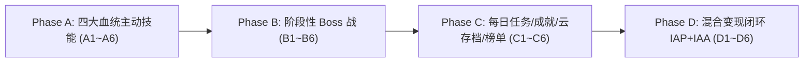

# 09 · P2-1 中后期留存玩法与商业化闭环升级 — 详细待开发实施方案（Step-by-Step Plan）

> **文档定位**：将 [`07-REVIEW_AND_ACTION_PLAN.md`](./07-REVIEW_AND_ACTION_PLAN.md) 中的 **P2-1（中后期留存玩法与商业化闭环升级）** 拆解为 **4 大模块、24 个原子化可勾选步骤（`A1~A6` / `B1~B6` / `C1~C6` / `D1~D6`）**，明确 Web（TypeScript + React + Canvas）与 iOS（Swift + SpriteKit + SwiftUI）双端落盘文件、核心数值契约、红线护栏及单步验收标准（DoD）。
> **状态说明**：`[ ]` 待开发 ｜ `[-]` 进行中 ｜ `[x]` 已完成并验证
> **创建日期**：2026-11-25
> **前置基线**：已完成 `P0-1`、`P0-2`、`P0-3`、`P1-1`、`P1-2`、`P1-3`、`P2-2` 与 iOS `iOS-P0-1~3`、`iOS-P1-1~4`、`iOS-P2-1`；当前全库含 48 阶鲨鱼（4 大血统）、235 种海洋猎物与障碍、`shared/game_data.json` 跨端共享契约及合规广告状态机。

---

## 一、总体架构与工程红线对齐（Pre-Flight Alignment）

在实施 P2-1 的任一步骤前，必须严守 [`00-AI_CONSTRAINTS.md`](./00-AI_CONSTRAINTS.md) 六大红线：
1. **纯本体进化（严禁外挂部件）**：Phase A 血统主动技能的视觉效果仅限能量冲击波、电弧场、火焰光环、黑洞漩涡等**环境能量粒子与光效**，严禁在 `drawSharkEntity` / `OceanGameScene` 鲨鱼本体上拼接外置炮台或机械肢体。
2. **视觉尺寸 === 物理碰撞同源**：Phase B 新引入 Boss 及投射物（深水炸弹、鱼雷）必须按单一 1:1 世界坐标与真相机变焦（`CAMERA_ZOOM_MIN = 0.22`）计算碰撞，投射物使用固定长度环形对象池，**60FPS 零 GC**。
3. **移动端多指触控零阻塞**：新增的血统主动技能按键必须沿用 Web `bindMultiTouchButton` 与 iOS `UIKit` 多指叶子视图隔离（拖动左手摇杆时右手点击技能 100% 即时响应，不触发根视图 60Hz 重绘）。
4. **共享 JSON 单一数据源（Web ↔ iOS）**：Phase A~D 所有新增数值表（技能参数、Boss 参数、每日任务/成就模板、内购商品配置）均定义于 Web TypeScript 并通过 `src/game/sharedGameData.ts` + `npm run sync:ios` 自动同步进 `shared/game_data.json` 与 `GameConfigGenerated.swift`。
5. **向后兼容存档升级**：`SharkMetaSaveData` 由 `v1` 升级为 `v2` 时，Web `loadSharkMetaSave()` 与 Swift `Codable init(from:)` 必须为新增字段提供安全默认值，保证老玩家存档 100% 无损继承。

### 模块依赖与建议开发顺序

- **总进度概览**：
  - [ ] **Phase A**：四大血统差异化主动技能（`0 / 6` 步）
  - [ ] **Phase B**：阶段性深海 Boss 战事件系统（`0 / 6` 步）
  - [ ] **Phase C**：每日任务、里程碑成就、云存档与排行榜（`0 / 6` 步）
  - [ ] **Phase D**：混合变现闭环（去广告礼盒 / 基因月卡 / 限时特惠鲨）（`0 / 6` 步）

---

## 二、Phase A · 四大血统差异化主动技能（Active Bloodline Skills）

> **设计目标**：让 4 大血统（`APEX_BIO` / `CYBER_MECHA` / `ELEMENTAL_CORE` / `ELDER_ABYSS`）不再只是被动数值差异，局内拥有鲜明的战术主动技，配合已内置于 `icons_f5128c12.webp` 第 4 行的 `UI_LINEAGE_BIO / MECHA / ELEM / ABYSS` 徽章形成完整操作闭环。

### 2.1 四大技能数值规格表

| 血统 (`SharkLineageId`) | 技能 ID & 名称 | 基础 CD（随代际 -1s/gen） | 持续时长 | 核心实战机制与爽点 | 能量/视觉表现 |
| :--- | :--- | :---: | :---: | :--- | :--- |
| **`APEX_BIO`**（远古狂暴） | `APEX_SAVAGE_ROAR` **血嗜狂潮** | `22s`（最低 `17s`） | `5.5s` | 发出深海震慑声波：周围猎物减速至 `0.35x` 停止逃窜；大嘴吸附半径 **`+65%`**；咬合阶位临时 **`+2T`**；吞噬回血 **`1.5x`** | 猩红扩张声波环 + 鲨鱼口部红金气场残影 |
| **`CYBER_MECHA`**（赛博机甲） | `MECHA_EMP_OVERDRIVE` **电磁脉冲炮** | `24s`（最低 `18s`） | `6.0s` | 释放 `520px * invZoom` 电磁脉冲：**瞬间震毁范围内水雷并爆出双倍金币/基因**；潜艇与装甲猎物定身 `3.0s` 且无视护甲可破甲；期间**冲刺零能耗** + 速度 `+35%` | 青蓝色环形 EMP 电弧冲击波 + 蓝色离子尾流 |
| **`ELEMENTAL_CORE`**（地心元素） | `ELEMENTAL_SOLAR_NOVA` **熔核爆裂** | `26s`（最低 `20s`） | `5.0s` | 引爆半径 `440px * invZoom` 烈阳力场：直接秒杀 `<= biteTier + 3` 猎物并 **100% 黄金转化（3x 分数与金币）**；立即补充 `+2` 狂热充能并锁定连击计时不衰减 | 炽橙日冕爆裂火环 + 熔岩火花对象池喷射 |
| **`ELDER_ABYSS`**（克苏鲁深渊） | `ABYSS_VOID_SINGULARITY` **虚空黑洞** | `25s`（最低 `19s`） | `5.5s` | 在前方 `260px` 生成旋转黑洞奇点：将 `680px * invZoom` 内猎物与掉落物持续拉向中心并施加高频压碎伤害；期间**饥饿掉血暂停**，基因产出 **`+50%`** | 深紫黑洞漩涡贴图 + 向心粒子吸积流 |

### 2.2 分步开发 Check 清单（Phase A）

- [ ] **Step A1 · 定义血统技能配置与跨端共享契约**
  - **改动文件**：新增 `src/game/bloodlineSkills.ts`；更新 `src/game/sharedGameData.ts`、`src/game/i18n.ts`、`ios-native/HungrySharkEvolution/Generated/GameConfigGenerated.swift`、`ios-native/HungrySharkEvolution/Core/GameRules.swift`。
  - **具体动作**：
    1. 定义 `BloodlineSkillConfig`（`id`、`lineage`、`iconKey`、`nameZh/En`、`descZh/En`、`baseCooldownSec`、`minCooldownSec`、`durationSec`、`effectRadiusPx`、`biteTierBonus`、`suctionBonus`、`geneYieldBonus`）。
    2. 编写纯函数 `getBloodlineSkillForShark(form)` 与 `computeEffectiveSkillCooldown(skill, generationRow)`。
    3. 接入 `buildSharedGameData()`（`bloodlineSkills` 字段）并通过 `npm run sync:ios` 同步至 Swift `Codable` 加载器。
  - **DoD**：`tsc --noEmit` 0 Error；`game_data.json` 含 4 条完整血统技能配置与双语键。

- [ ] **Step A2 · 引擎仿真状态机与零 GC 效果管线**
  - **改动文件**：`src/game/sim/types.ts`、`src/game/sim/stepSimulation.ts`、`src/game/rules.ts`、`ios-native/HungrySharkEvolution/State/GameViewModel.swift`、`ios-native/HungrySharkEvolution/Rendering/OceanGameScene.swift`、`PreySimulation.swift`。
  - **具体动作**：
    1. 在 `SharkSimState` 与 `GameViewModel` 新增 `skillState`（`cooldownRemaining`、`cooldownTotal`、`activeRemaining`、`singularityX/Y`）。
    2. 实现 `triggerBloodlineSkill()`：校验非暂停/非死亡/CD 归零后激活；每帧更新计时，将 `biteTierBonus`（`+2T`）、`boostCost=0`、`hpDrain=0` 等临时增益汇入 `computeEvolvedSharkStats()` 或仿真修饰器。
    3. 在猎物循环接入 EMP 清雷爆奖、虚空黑洞向心引力拉扯、日冕秒杀黄金转化与声波减速效果。
  - **DoD**：60FPS 循环内零每帧数组分配（使用既有环形粒子/掉落池）；EMP 在浅海外能安全清除水雷并结算分数/金币。

- [ ] **Step A3 · Canvas & SpriteKit 技能视觉特效渲染**
  - **改动文件**：`src/game/canvasRenderer.ts`、`src/game/sim/renderOceanWorld.ts`、`ios-native/HungrySharkEvolution/Rendering/OceanFXSystem.swift`。
  - **具体动作**：
    1. 基于 `sim.skillState` 绘制扩张型冲击波（红/青/橙）及奇点漩涡（紫）。
    2. **严格遵守红线 1**：所有渲染全部作为世界层/角色周身能量场，不改动鲨鱼躯干结构、不添加外挂配件。
  - **DoD**：Web Canvas 与 iOS SpriteKit 在真相机变焦（`0.22 ~ 1.00`）下特效半径与实际物理作用范围 1:1 匹配。

- [ ] **Step A4 · 双端多指触控技能按键与 CD 扇形 UI**
  - **改动文件**：`src/components/game/InGameHudOverlay.tsx`、`src/index.css`、`ios-native/HungrySharkEvolution/UI/ModalsAndSkillFanViews.swift`、`UI/Components/HudLeafViews.swift`。
  - **具体动作**：
    1. 复用图集已有图标 `UI_LINEAGE_BIO / MECHA / ELEM / ABYSS`，在右下角技能区外侧或左下摇杆上方增加血统专属技能按钮（带 SVG / SwiftUI 扇形倒计时蒙层与激活脉冲光环）。
    2. Web 端必须通过 `bindMultiTouchButton(handleTriggerSkill, disabled)` 绑定；iOS 端纳入独立叶子视图订阅 `HudTelemetryStore`（18Hz 同步 CD 秒数），确保摇杆拖动期间根视图 0 重绘。
    3. 接入桌面端快捷键（如 `E` / `Q`）方便 PC 端测试与游玩。
  - **DoD**：移动端实机测试左手持续摇杆转向时，右手点击技能按钮 100% 即时触发。

- [ ] **Step A5 · 技能音效与触感反馈**
  - **改动文件**：`src/game/audio.ts`、`ios-native/HungrySharkEvolution/Audio/OceanAudioEngine.swift`。
  - **具体动作**：为 4 种血统技能合成专属触发音效（低频咆哮 / 电弧爆鸣 / 火焰爆震 / 虚空嗡鸣）并触发重型触感 `HapticFeedbackManager.shared.playHeavy()`。
  - **DoD**：静音模式下不发声，切后台不泄漏音频节点。

- [ ] **Step A6 · Phase A 双端单元测试补齐**
  - **改动文件**：`src/game/rules.test.ts`、`ios-native/HungrySharkEvolutionTests/GameRulesTests.swift`。
  - **具体动作**：新增 `P2-1 Phase A` 单测覆盖 4 血统技能映射、代际 CD 缩减边界、临时 `+2T` 咬合破甲、EMP 清雷倍率及 JSON 契约一致性。
  - **DoD**：`rules.test.ts` 与 `xcodebuild test` 全绿。

---

## 三、Phase B · 阶段性深海 Boss 战事件系统（Periodic Boss Encounters）

> **设计目标**：将当前普通巡游形态的 `KRAKEN_BOSS` 升级为具有明确**预警 → 多阶段机制 → 弱点破防 → 专属宝箱爆奖**的阶段性高潮事件，打破中后期纯刷鱼的平铺疲劳。

### 3.1 三大阶段性 Boss 规格表

| Boss ID & 名称 | 触发海域 / `worldY` | 触发条件 & 冷却 | 核心战斗机制 | 击败专属奖励 |
| :--- | :--- | :--- | :--- | :--- |
| **`boss_hunter_warship`** 钢铁猎鲨战舰「利维坦猎手号」 | 表层/近海 `0 ~ 2,500 px`（`0 ~ 300m`） | 存活 `>= 90s` 且非新手引导期 冷却 `180s` | 海面巡航投掷带红色预警圈（`1.2s telegraph`）的深水炸弹；船底螺旋桨为弱点，冲刺撞击 **4 次**击沉 | `+250 🪙` + `+18 🧬` + 1 个高价值 `SUPPLY_CHEST` 宝箱 |
| **`boss_nuclear_sub`** 深渊核动力潜艇「蝰蛇号」 | 暮光/半深海 `4,000 ~ 9,500 px`（`600 ~ 3,500m`） | 进入暮光下层且 `biteTier >= 12` 冷却 `210s` | 双阶段循环：① 声呐锁定发射跟踪鱼雷（可被冲刺或 EMP 摧毁）→ ② 过热冷却 `4.5s` 暴露核反应堆弱点，冲刺击穿 **5 次**引爆 | `+550 🪙` + `+45 🧬` + 立即补满冲刺能量 + 触发 5 秒黄金狂热 |
| **`boss_abyssal_kraken`** 旧日海妖「克拉肯虚空本体」 | 深渊/超深渊海沟 `10,000 ~ 19,500 px`（`4,000 ~ 11,000m`） | 进入深渊区且 `biteTier >= 24` 冷却 `240s` | 3 层虚空护盾 + 触手蓄力猛击预警 + 黑洞墨汁涡流；破盾后进入 `6.0s` 虚弱期，高阶鲨鱼可重击斩杀或直接吞噬 | `+1,200 🪙` + `+110 🧬` + 解锁对应 Boss 击杀成就里程碑 |

### 3.2 分步开发 Check 清单（Phase B）

- [ ] **Step B1 · 定义 Boss 配置、遭遇调度与投射物对象池**
  - **改动文件**：新增 `src/game/bossSystem.ts`；更新 `src/game/sharedGameData.ts`、`src/game/sim/types.ts`、`ios-native/.../Generated/GameConfigGenerated.swift`。
  - **具体动作**：
    1. 定义 `BossEncounterConfig` 与 `BossEncounterState`（`IDLE / WARNING / ACTIVE / DEFEATED`）及投射物环形对象池（`MAX_BOSS_PROJECTILES = 16`，零 GC）。
    2. 严格约束：**新手保护期（`tutorialStep !== 'DONE'`）及浅滩安全区护航期绝不触发 Boss**。
  - **DoD**：调度状态机为纯 TS 可测函数，支持注入确定性时钟与深度触发测试。

- [ ] **Step B2 · 入场预警演出与边缘雷达追踪**
  - **改动文件**：`src/game/canvasRenderer.ts`、`src/components/game/InGameHudOverlay.tsx`、`ios-native/.../UI/ContentView.swift`、`OceanGameScene.swift`。
  - **具体动作**：
    1. 触发前 `4.0s` 显示顶部双语警示横幅（如「⚠️ 深海警报：核动力潜艇逼近！」）并播放低频声呐警报。
    2. Boss 在视野外时，复用并扩展 `drawOffScreenRadarIndicators` 绘制 Boss 专属红色骷髅/锚点雷达指示与距离米数。
  - **DoD**：玩家不会在毫无防备下被屏外 Boss 突脸秒杀。

- [ ] **Step B3 · Boss 多阶段 AI、弱点判定与投射物交互**
  - **改动文件**：`src/game/sim/stepSimulation.ts`、`src/game/canvasRenderer.ts`、`ios-native/.../Rendering/OceanGameScene.swift`。
  - **具体动作**：
    1. 实现 Boss 巡航/蓄力红光预警（`telegraphTimer`）/ 投射物发射与碰撞 / 冲刺命中弱点减盾或击退。
    2. 若玩家在远超出该 Boss 承受深度离开（距离 `> 3,200px * invZoom` 持续 `> 8s`），Boss 平滑脱战退场进入冷却，避免死锁。
  - **DoD**：三种 Boss 均具备清晰的“躲避攻击 → 抓弱点冲刺破防 → 斩杀爆奖”节奏；击破护盾时触发 Hitstop 与震屏。

- [ ] **Step B4 · 专属 Boss HUD 血条与护甲分段条**
  - **改动文件**：`src/components/game/InGameHudOverlay.tsx`、`ios-native/.../UI/Components/HudLeafViews.swift`、`State/HudTelemetryStore.swift`。
  - **具体动作**：仅当 `bossState.phase === 'ACTIVE'` 时在屏幕顶部显示紧凑型 Boss 名称 + 护甲格 + HP 血条（Web/iOS 均走节流状态同步，不阻塞主 UI）。
  - **DoD**：Boss 退场或击败后血条立即平滑收起，不遮挡核心视野与右上角暂停按钮。

- [ ] **Step B5 · `SUPPLY_CHEST` 宝箱拾取机制激活**
  - **改动文件**：`src/game/sim/stepSimulation.ts`、`src/game/sim/types.ts`（已定义 `'SUPPLY_CHEST'` 枚举）、`ios-native/.../Rendering/OceanFXSystem.swift`。
  - **具体动作**：击沉/击败 Boss 后在战场散落 1 个金色深海补给箱拾取物，吸入嘴部后发放额外金币、基因并立即激活 `5.0s` 黄金狂热奖励期。
  - **DoD**：宝箱复用既有 `PooledPickup` 环形池，不额外分配对象。

- [ ] **Step B6 · Phase B 双端单元测试补齐**
  - **改动文件**：`src/game/rules.test.ts`、`ios-native/HungrySharkEvolutionTests/GameRulesTests.swift`。
  - **具体动作**：测试 3 个 Boss 的触发深度门禁、新手引导期屏蔽、冷却计时、弱点破盾次数递减与击杀奖励结算。
  - **DoD**：`rules.test.ts` 与 `xcodebuild test` 全绿。

---

## 四、Phase C · 每日任务、里程碑成就、云存档与排行榜（Retention Meta）

> **设计目标**：建立跨天回流钩子（每日 3 任务 + 宝箱）、中长线目标阶梯（12 项生涯成就）、防丢失跨设备存档合并与竞技排行。

### 4.1 存档 Schema v2 兼容性设计

在 `SharkMetaSaveData`（TS 与 Swift 同步）新增以下可选/带默认值的字段（`version: 2`）：
- `dailyMissions`: `{ dateKey: string; refreshUsed: number; bonusClaimed: boolean; slots: DailyMissionSlot[] }`
- `achievements`: `Record<string, { claimedTier: number }>`（12 条成就各自当前已领奖阶位 `0..3`）
- `lifetimeStats`: `{ totalPreyEaten: number; totalSkillsUsed: number; totalBossesDefeated: number; totalArmorCrushed: number; maxSingleRunScore: number }`
- `cloudSyncMeta`: `{ lastSyncedAt: number; userId?: string; provider: 'local' | 'firebase' | 'icloud' }`

### 4.2 分步开发 Check 清单（Phase C）

- [ ] **Step C1 · `SharkMetaSaveData` v2 扩展与老存档无损迁移**
  - **改动文件**：`src/game/sharkEvolutionConfig.ts`、`ios-native/HungrySharkEvolution/Core/GameRules.swift`。
  - **具体动作**：扩展 `SharkMetaSaveData` 字段；确保读取不含新字段的 `v1` JSON 时自动补齐 `createDefaultDailyMissions()` 与空统计对象，**零数据丢失**。
  - **DoD**：使用 v1 旧存档样本 JSON 执行 `loadSharkMetaSave()` 与 Swift `JSONDecoder().decode` 100% 成功且原金币/基因/解锁鲨鱼完整保留。

- [ ] **Step C2 · 每日任务 & 里程碑成就纯逻辑引擎**
  - **改动文件**：新增 `src/game/retentionSystem.ts`；更新 `src/game/sharedGameData.ts`、`src/game/sim/stepSimulation.ts`、`ios-native/.../Core/GameRules.swift`、`State/GameViewModel.swift`。
  - **具体动作**：
    1. 设计 **12 个每日任务模板**（吞噬数量、潜深达标、血统技能使用次数、破甲次数、单局连击、击败 Boss 等），按本地日期确定性抽取 3 个不重复槽位（简单/进阶/挑战）。
    2. 设计 **12 项三阶生涯成就**（累计吞噬、累计潜深、解锁鲨鱼数、收集王冠数、Boss 击杀、技能释放次数等），提供固定基因奖励池。
    3. 实现纯函数 `applyRunProgressToRetention(save, runSummary)` 与幂等领奖 `claimDailyMissionReward()` / `claimDailyBonusChest()` / `claimAchievementTier()`。
  - **DoD**：跨日自动重置每日任务；同一任务/成就不可重复领奖；单局结算自动累加生涯数据与任务进度。

- [ ] **Step C3 · 任务与成就弹窗 UI（Web + iOS）**
  - **改动文件**：新增 `src/components/MissionsAndAchievementsModal.tsx`；更新 `src/components/game/TitleScreenOverlay.tsx`、`GameOverModalOverlay.tsx`；iOS 新增 `UI/MissionsSheetView.swift` 并接入 `ContentView.swift`。
  - **具体动作**：
    1. 主界面与结算页增加「每日任务 / 成就」入口按钮与**未领奖小红点徽标**。
    2. 支持激励视频「换一换」刷新未完成任务（接入 P0-3 `adManager.showRewardedVideoAd`），全部完成亮起「领取每日宝箱」。
  - **DoD**：所有 UI 文案支持中英双语切换，适配横屏小屏不溢出。

- [ ] **Step C4 · 云存档接口抽象与跨端合并协议**
  - **改动文件**：新增 `src/game/cloudSync.ts`；iOS 新增 `State/CloudSaveManager.swift`。
  - **具体动作**：
    1. 实现纯函数 `mergeMetaSaves(local, remote): SharkMetaSaveData`：取 `unlockedSharkIds` 并集、各鲨鱼 `upgradeLevel / bestScore / masteryTier` 取 `max()`、成就与累计统计取 `max()`、双货币按权威时间戳与单调规则合并。
    2. **Web 端**：提供即刻可用的**加密存档导入/导出码（Base64 + 校验和）**弹窗 + 可选 Firebase/REST Adapter 钩子。
    3. **iOS 端**：封装 `NSUbiquitousKeyValueStore`（iCloud Key-Value Store）实现同 Apple ID 跨设备自动静默同步，并在设置弹窗显示同步状态。
  - **DoD**：离线状态不阻塞游戏启动与本地保存；`mergeMetaSaves` 对任意乱序/断网双端冲突都能无损保留最高解锁进度。

- [ ] **Step C5 · 排行榜系统集成（Web + iOS Game Center）**
  - **改动文件**：新增 `src/components/LeaderboardModal.tsx`；iOS 新增 `State/GameCenterManager.swift` 并接入 `ContentView.swift` / `GameOverModalOverlay`。
  - **具体动作**：
    1. 定义 3 个核心榜单维度：**历史单局最高分**、**最大下潜深度**、**解锁鲨鱼与王冠荣耀榜**。
    2. **Web 端**：支持本机 48 阶高分榜 + 远端排行榜 API 适配器（无后端时优雅降级展示本机历史 Top 10 与全网占位段位对比）。
    3. **iOS 端**：接入 `GameKit`（`GKLocalPlayer.authenticateHandler` + `GKLeaderboard.submitScore` + `GKGameCenterViewController` 原生弹窗，并在项目说明中标明需开启 Xcode Game Center Capability）。
  - **DoD**：未登录 Game Center 或无网络时绝不弹窗报错打断结算流程。

- [ ] **Step C6 · Phase C 单元测试补齐**
  - **改动文件**：`src/game/rules.test.ts`、`ios-native/HungrySharkEvolutionTests/GameRulesTests.swift`。
  - **具体动作**：覆盖 v1->v2 存档迁移、跨日重置、领奖防重刷、随机池不重复抽取以及 `mergeMetaSaves` 冲突合并单测。
  - **DoD**：`rules.test.ts` 与 `xcodebuild test` 全绿。

---

## 五、Phase D · 混合变现闭环升级（Hybrid Monetization · IAP + IAA）

> **设计目标**：在已完成 P0-3（广告频控与防白嫖）及 iOS-P0-1（AdMob 合规）的基础上，补充轻量高转化的 IAP 内购商品，形成“广告变现（IAA）+ 轻度内购（IAP）”双引擎收入模型。

### 5.1 核心混合变现商品矩阵

| 商品 ID (`productId`) | 商品名称 | 商品类型 | 核心权益与内容 | 合规与转化设计 |
| :--- | :--- | :---: | :--- | :--- |
| **`iap_remove_ads_bundle`** | 深海探索者去广告礼盒 | 非消耗型（买断） | • **永久移除结算插屏广告** • 每日赠送 2 张「免广告跳过券」（可直接免看激励视频领复活/双倍/空投奖励） • 立得 `+1,500 🪙 +120 🧬` | 高性价比破冰首充礼盒；支持「恢复购买」 |
| **`iap_gene_monthly_pass`** | 深海基因月卡 | 30 天订阅 / 时效通行证 | • 购买立得 `+300 🧬` • 每日登录领取 `+50 🧬 + 300 🪙` • 局内基因掉落 **`+35%`**、血统技能 CD **`-15%`** | 锁定 30 天高留存复访；清楚标明到期日与权益 |
| **`iap_flash_shark_offer`** | 限时特惠神鲨礼包 | 消耗型（动态推荐） | • 针对玩家当前**下一代进化目标或高人气血统鲨**（卡门禁时推荐），直接解锁该鲨鱼并赠送升至 Lv.5 所需强化包 | 48h 限时倒计时触发；配合现有「看广告试驾」形成先体验后购买漏斗 |

### 5.2 分步开发 Check 清单（Phase D）

- [ ] **Step D1 · 商业化商品配置与特权数值接口**
  - **改动文件**：新增 `src/game/monetizationConfig.ts`；更新 `SharkMetaSaveData`（新增 `entitlements`: `adFree`, `adSkipTickets`, `monthlyPassExpiresAt`, `lastMonthlyClaimDate`, `flashOfferExpiresAt`）、`sharedGameData.ts`、`GameConfigGenerated.swift`。
  - **具体动作**：
    1. 定义商品目录 `IAP_PRODUCTS` 与特权查询纯函数 `isAdFreeActive(save)`、`isMonthlyPassActive(save, nowMs)`、`getMonthlyPassStatModifiers(save, nowMs)`。
    2. 将基因月卡 `+35%` 基因掉落与 `-15%` 技能 CD 接入 `computeEvolvedSharkStats()` 与 `computeEffectiveSkillCooldown()`。
  - **DoD**：商品 ID、本地化展示名、权益数值在 Web 与 iOS 保持 100% 共享一致。

- [ ] **Step D2 · 跨端支付适配器与 iOS StoreKit 2 原生实现**
  - **改动文件**：新增 `src/game/storeAdapter.ts`；iOS 新增 `ios-native/.../Monetization/StoreKitManager.swift` 与本地测试配置 `Products.storekit`。
  - **具体动作**：
    1. **iOS 端**：使用现代 `StoreKit 2`（`Product.products(for:)`、`product.purchase()`、`Transaction.updates` 后台监听、`Transaction.currentEntitlements` 状态恢复与 `AppStore.sync()` 恢复购买按钮）。
    2. **Web / 小游戏端**：抽象 `StoreAdapter` 接口（支持微信 `requestMidasPayment` / 抖音 / Web Stripe 或显式沙盒测试开关），严禁无凭据直接白嫖发奖。
  - **DoD**：满足 Apple App Store Review Guidelines 3.1.1：无任何绕过 IAP 的外链支付、提供显式「恢复购买」按钮并正确处理取消/挂起/退款交易。

- [ ] **Step D3 · 广告系统接入去广告特权与免广告券机制**
  - **改动文件**：`src/game/adManager.ts`、`ios-native/.../Monetization/GoogleAdMobManager.swift`、`src/App.tsx`、`ios-native/.../State/GameViewModel.swift`。
  - **具体动作**：
    1. 当 `entitlements.adFree === true` 时，`showInterstitialAd()` 直接短路静默跳过，不再展示任何结算插屏。
    2. 玩家持有 `adSkipTickets > 0` 且点击激励视频入口（复活/双倍/空投/试驾）时，弹窗提供或优先使用「免广告跳过券（-1张）」直接安全发奖并记录防重。
  - **DoD**：跳过券扣减具备原子性（为 0 时回落真实激励广告流程，绝不白嫖）。

- [ ] **Step D4 · 商店、月卡领奖与限时特惠弹窗 UI**
  - **改动文件**：新增 `src/components/ShopModalOverlay.tsx`；更新 `TitleScreenOverlay.tsx`、`SharkEvolutionAtlasModal.tsx`；iOS 新增 `UI/ShopSheetView.swift`。
  - **具体动作**：
    1. 主界面顶部与进化图谱缺资源提示处增加「深海补给站（Shop）」入口。
    2. 商店页展示 3 大板块：去广告礼盒卡片、基因月卡状态与每日一键领奖按钮、动态推荐限时特惠鲨卡片（附带「先看广告试驾」引导按钮），底部显著位置提供「恢复购买（Restore Purchases）」。
  - **DoD**：UI 视觉与现有深海科幻风格一致，移动端横竖屏及刘海屏安全区零遮挡。

- [ ] **Step D5 · 商业化与留存埋点契约 (`AnalyticsTracker`)**
  - **改动文件**：新增 `src/game/analytics.ts`；iOS 新增 `State/AnalyticsTracker.swift`。
  - **具体动作**：定义轻量可扩展事件接口（`ad_requested / ad_completed / ad_blocked_cooldown`、`skill_triggered`、`boss_spawned / boss_defeated`、`mission_claimed`、`shop_opened / iap_initiated / iap_succeeded / iap_restored`），默认控制台静默/可挂载外部 SDK（Firebase Analytics / 友盟等）。
  - **DoD**：所有关键商业化漏斗节点有清晰结构化事件输出，无敏感隐私数据（符合 `PrivacyInfo.xcprivacy` 声明）。

- [ ] **Step D6 · Phase D 单元测试与 StoreKit 沙盒全检**
  - **改动文件**：`src/game/rules.test.ts`、`ios-native/HungrySharkEvolutionTests/GameRulesTests.swift`。
  - **具体动作**：测试买断去广告拦截插屏、跳过券扣减归零边界、月卡过期判定与属性失效、重复交易 ID 幂等防重发奖逻辑；在 Xcode 配置 `Products.storekit` 验证购买与恢复购买流程。
  - **DoD**：`rules.test.ts`、`tsc --noEmit`、`vite build` 与 `xcodebuild test` 全量通过。

---

## 六、总验收里程碑与上线前门禁（Final Release Gate）

当以上 `A1~D6` 共 24 步全部打勾完成后，执行最终全链路回归门禁：
- [ ] **门禁 1**：`npm run sync:ios` 同步生成最新 `shared/game_data.json` 与 Xcode 工程配置，零报错。
- [ ] **门禁 2**：`npm run lint`（`tsc --noEmit`）0 Error，`npx tsx --test src/game/rules.test.ts` 100% 通过，`npm run build` 打包成功。
- [ ] **门禁 3**：`xcodebuild test` 在 iOS Simulator 全量通过，真机开启 Game Center / iCloud / StoreKit 沙盒账号实测购买、恢复购买与跨设备云存档合并。
- [ ] **门禁 4**：同步更新 `docs/01-ARCHITECTURE.md`、`docs/02-DESIGN_SPEC.md`、`docs/03-GAME_BALANCE_AND_NUMERICAL_DESIGN.md` 与 `docs/07-REVIEW_AND_ACTION_PLAN.md`（将 `P2-1` 勾选为 `[x]`）。
