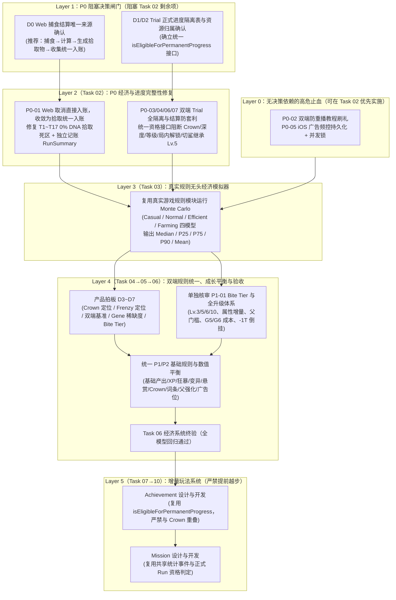

# 经济系统已确认问题分级与修复路线图 (`ECONOMY_FIX_ROADMAP.md`)

> **最后更新**：2026-11-25  
> **文档性质**：基于 [`ECONOMY_AUDIT_VERIFICATION.md`](./ECONOMY_AUDIT_VERIFICATION.md) 与 [`ECONOMY_SOURCE_SINK.md`](./ECONOMY_SOURCE_SINK.md) 的代码级核实结果，并逐行复核 Web（`src/`）与 iOS（`ios-native/HungrySharkEvolution/`）当前源码后建立的**正式缺陷分级清单、修复依赖关系、Trial 隔离规范与产品决策清单**。  
> **当前阶段状态（Task 02 已完成，等待验收）**：`D0`、`D1`、`D2` 产品决策已拍板，**P0 问题已全部完成修复并经双端单元测试验证（详见 [P0_ECONOMY_FIX_REPORT.md](file:///Users/ev/Projects/hs_ios/hungry_shark/docs/P0_ECONOMY_FIX_REPORT.md)）**。当前严格停在 P0 验收边界：未修改 P1/P2 经济数值，未开发 Achievement 与 Mission。下一步待审阅通过后启动 Task 03（基于真实规则的经济模拟器）。

---

## 一、问题总览与分级统计

经核对 Web 与 iOS 实际源码，共确认 **23 项** 独立问题，按严重度分为三层：

| 分级 | 定位定义 | 确认数量 | 核心问题聚焦 |
| :--- | :--- | :---: | :--- |
| **P0** | **影响存档、经济底盘或进度完整性（双重入账 / 无限刷礼 / 试玩污染 / 套利漏洞）** | **7 项** | Web 捕食双重入账及 `runSnapshot` 混叠、双端重播新手引导无限刷礼、iOS 试玩领取未解锁鲨鱼王冠、双端试玩污染 `bestInRunLevel` / `bestDepthReached` 与 Web 局内实时 `evaluateSharkUnlock` 泄露、iOS 广告频控纯内存可重启清零与缺防连点锁、iOS `DOUBLE_SETTLEMENT` 毛收益套利与保底漏洞、试玩途中买鲨/切鲨保留 `Lv.5` 且计数 `totalRuns` |
| **P1** | **破坏成长体系或跨平台经济平衡** | **8 项** | `Bite Tier`（`Lv.3/6/10`）与基因收费（`Lv.4→5 / Lv.9→10`）错位（含 `#23→#46` 23 阶 `-1T` 倒挂）、双端基础掉率/XP 阻尼/时间饥饿/破甲规则分裂、狂暴货币倍率/阈值/冷却分裂、变异生态差异（`ABYSS_BEHEMOTH` 与黄金率）、悬赏模型分裂、Crown 金币奖励导致 iOS 前期溢出（G1~G3 送 `71,341C > 45,921C` 需求）、iOS 缺失 8 只鲨特殊词条与 `#39` Boss 倍率、父级强制强化成本反超解锁最高 `2.56x` 及 `#0` 基因底数分歧（`max(20)` vs `max(8)`） |
| **P2** | **功能一致性、体验差异与死代码清理** | **8 项** | 广告位/上限不对齐与 Web 死广告位、`GoldOverdrive` 冲突、`GeneSurge` 差异、试玩对象与规格差异、解锁父级候选链差异、拾取物寿命（永存 vs `11.0s`）/磁吸/`HuntingHeatBuff` 差异、iOS `getGlobalAtlasBonuses()` 王冠死词条与双端死枚举、初始档案默认深度差异（`220m` vs `180m`） |

---

## 二、修复依赖关系图（Strict Dependency DAG）

> **强制执行铁律**：
> 1. **先止血与定结算口径，再模拟**：必须先完成 Task 02（P0 漏洞修复 + 单一捕食结算源 + Trial 统一隔离门控），才能在 Task 03 运行有意义的经济模拟。
> 2. **模拟器必须复用真实代码逻辑**：禁止复制一份简化公式自行假设。Task 03 必须直接复用 `preyDatabase140`、`sharkEvolutionConfig`、`rules`、`ecosystemSpawner`、`infiniteProgressionManager`、`stepSimulation` / `PreySimulation` 等真实纯逻辑模块。
> 3. **禁止在模拟与方案批准前调数值**：任何强化成本、Crown 奖励、广告补给、Achievement/Mission 奖池数值，均须在 **Layer 3 模拟验证 → Layer 4 规则统一** 之后方可落盘。
> 4. **`Bite Tier` 节点独立核审**：`P1-01` 严禁未核对完整升级体系就直接改成 `Lv.5/Lv.10`，必须在 Task 04/05 单独对照全级属性收益、Lv.5 价值、Lv.6 突变、父鲨门槛与 G5/G6 成本后统一拍定。



---

## 三、正式修复矩阵（含核查后源码依据）

### 3.1 P0 级问题矩阵（存档、经济与进度完整性）

| ID | 问题 | 平台 | 优先级 | 影响范围 | 依赖 | 建议修复方式 | 风险 |
| :--- | :--- | :---: | :---: | :--- | :--- | :--- | :--- |
| **P0-01** | **Web 捕食奖励双重入账、`T1~T17` DNA 拾取 `0%` 死区及 `runSnapshot` 混入局内消费** | Web | **P0** | 吞噬时 `shark.coins/genes` 直接入账一次，随后再生成脱离鱼价的 `2..6` 个拾取物二次入账（放大 `3x~12x`）；`T1~T17` 普通鱼因 `drops=2..3` 致 `d%4===3` 永不触发 DNA 拾取（实为 `0%`）；局末 `runSnapshot` 按净余额差算收益导致局内花钱后统计失真 | 依赖 **D0**（结算规则确认） | ① **单一结算源**：按 `捕食事件 → resolvePreyEncounter 计算本次奖励 → 打包生成金币/基因拾取物 → 拾取收集统一入账` 重构（与 iOS `spawnDevourPickups` 架构一致）；特殊事件（如悬赏）可走独立直发而不产生重复拾取。<br>② **防重与对齐**：确保同一捕食事件不重复生成、同一 `PooledPickup` 拾取后立即失活不二次触发；普通鱼与特殊鱼/破甲按同一奖励来源结算，并同步修复 `T1~T17` 基因掉率公式。<br>③ **独立 Run 统计**：新增独立的 `runCoinsEarned / runGenesEarned` 累加器供 `RunSummary` 使用，避免混入升级或 `GoldOverdrive` 消费。 | 取消双重入账会立刻大幅降低 Web 当前异常偏高的单局产出，**绝对禁止在修复前后不跑 Task 03 模拟就擅自改高基础数值** |
| **P0-02** | **重播新手引导可双端无限刷取资源礼包** | Web & iOS | **P0** | Web 暂停点“重温新手引导”清除 `TUTORIAL_STORAGE_KEY`，每次冲刺达 `0.7s` 无限发放 `+80C / +20G`；iOS 点重播引导重置 `onboardingDoneKey=false`，当 `bankedCoins < firstCost` 时直接将 `bankedCoins` 补齐至当前鲨鱼当前升级的 `firstCost`（高阶鲨可反复补齐数千至上万金币） | **无决策阻塞（Layer 0 可立即修）** | ① 在 `SharkMetaSaveData` 中双端增加持久化一次性字段（如 `onboardingGiftClaimed: boolean` / `onboardingGiftClaimed: Bool`），仅首次完成第 2 步且未领取过时发奖。<br>② 重温新手引导（Replay）仅重置教学 UI 步骤提示，严禁重置 `onboardingGiftClaimed`；且 iOS 仅在初始第 0 阶首次未领取时执行小额兜底（或统一为固定一次性小礼包），绝不按高阶 `firstCost` 补钱。 | 需做好旧存档向后兼容：Web/iOS 老存档若已完成引导或已有进阶记录，解码默认 `onboardingGiftClaimed = true`，防止老玩家升级后多领一次 |
| **P0-03** | **iOS 试玩（Trial）可为未解锁高阶鲨领取正式王冠奖励与刷新个人最佳** | iOS | **P0** | iOS `finalizeRunSettlement()` 未传递 `trialSharkIdForRun` 状态，`settleSharkScoreMastery()` 会直接写入未解锁高阶鲨的 `sharkBestScores`、`sharkMasteryTiers` 并发放高额王冠金币与基因 | 依赖 **D2**（Trial 隔离表）与统一资格接口 | ① 建立统一正式进度资格判定接口（如 `isEligibleForPermanentProgress(runContext)`，当 `isTrial == true` 时返回 `false`）。<br>② 在 `GameViewModel.finalizeRunSettlement` 与 `GameRules.settleSharkScoreMastery` 接入该接口：Trial 局严禁写入 `sharkBestScores` / `sharkMasteryTiers`，王冠奖励归 `0`，UI 仅可展示本次模拟表现提示“试玩成绩不计入正式存档”。 | 对线上已因测试包刷出“未解锁鲨鱼却持有王冠档位”的旧存档需保持宽容读档（仅锁后续写入，不破坏已存字段或清零用户现有货币） |
| **P0-04** | **双端 Trial 污染正式门禁 `bestInRunLevel` / `bestDepthReached` 及 Web 局内实时解锁泄露** | Web & iOS | **P0** | ① 双端 Trial 局都会把试玩 `Lv.5+` 与深海深度写入永久存档 `bestInRunLevel` 与 `bestDepthReached / maxDepthReached`。<br>② **漏项补充**：Web 在 `startNewRun`、`handleUpgradeSharkForm`、`handleUnlockAndSelectSharkForm`、`handleInRunBreakthroughOrAtlas` 与 `120ms` HUD 同步中直接把实时 `sim.shark.level` / `sim.shark.maxDepthReached` 传入 `evaluateSharkUnlock()`，导致试玩中打开图鉴即可直接靠试玩等级/深度满足门禁并解锁新鲨！ | 依赖 **D1、D2** 与统一资格接口 | ① 所有永久记录写入（`bestInRunLevel`、`bestDepthReached / maxDepthReached`、`isNewRecord`、`totalRunsPlayed / totalRuns`）统一受 `isEligibleForPermanentProgress` 门控。<br>② Web 传给 `evaluateSharkUnlock()` 的实时 `liveRunLevel` / `liveRunMaxDepth` 在试玩局必须隔离为 `0`（仅读历史正式存档值 `save.bestInRunLevel / save.bestDepthReached`），彻底堵死局内图鉴实时借用试玩等级/深度解锁新鲨的旁路。 | 若 D1 最终禁止 Trial 带出资源，需确保试玩退出或结算时 `save.bankedCoins / bankedGenes` 也不受试玩内加减污染 |
| **P0-05** | **iOS 广告冷却与每日上限纯内存存储 + 缺防连点并发锁** | iOS | **P0** | 杀进程重启 iOS App 即清空 `lastGrantedAtByKind`、`dailyGrantCountByKind`、`dailyCapDayKey`（`90s` 冷却与每日 10 次补给等上限全部归零）；`rewardedAd == nil` 加载期连续点击 `showRewardedAd` 会覆盖 `pendingRewardAction` 与 `activeAdKind` | **无决策阻塞（Layer 0 可立即修）** | ① 参照 Web `adManager.ts` (`hs_ad_freq_v1`)，在 `GoogleAdMobManager` 中将 `dailyCapDayKey`、`lastGrantedAtByKind`、`dailyGrantCountByKind` 持久化至 `UserDefaults`。<br>② 在 `showRewardedAd` 入口增加 `isConnectingAd` / 展示中互斥锁（对应 Web `IN_FLIGHT`），阻止并发请求覆盖回调或重复触发奖励。 | 本地 `dailyCapDayKey` 依赖设备本地时钟，无服务端下无法防范修改系统日期，属单机架构可接受边界 |
| **P0-06** | **iOS `DOUBLE_SETTLEMENT` 按累计毛收益翻倍（无视局内消费、含 Trial、且有 `+30C/+5G` 空手保底）** | iOS | **P0** | ① `runCoinsEarned / runGenesEarned` 只增不减，局内把赚到的钱全买强化/狂暴后局末仍能再拿全额 `100%` 奖励。<br>② Trial 局结束弹窗照常显示翻倍按钮，可翻倍试玩高阶收入。<br>③ 哪怕本局赚 `0C/0G`，`max(30, runCoinsEarned)` / `max(5, runGenesEarned)` 仍保底发 `+30C / +5G`（每日上限 20 次，相当于开局自杀刷保底）。 | 依赖 **D1** | ① 若 Trial 禁用带出或受限，Trial 局结算面板禁用/隐藏 `DOUBLE_SETTLEMENT` 入口并在 `grantAdReward` 后端二次拦截。<br>② 取消 `0` 收益硬送 `30C/5G` 保底（改为无收益则不显示翻倍或仅对有效正收益翻倍），并在 Task 04/05 统一约定翻倍基数与单局上限（净收益或独立打捞池）。 | 若直接改为“净收益（扣除局内买鲨/强化消费）”，可能出现玩家局内花了钱后结算翻倍显示 `+0` 引发困惑，建议统一改为“本局有效打捞所得（仅正式局且有正收益门槛）” |
| **P0-07** | **Trial 局内允许购买/升级正式鲨鱼，且切回正式鲨后保留试玩 `Lv.5` 起步等级与深海状态；`totalRuns` 计数错乱** | Web & iOS | **P0** | ① Web `handleSelectActiveSharkForm` / `handleUnlockAndSelectSharkForm` 与 iOS `unlockSharkForm` / `selectSharkForm` 在 Trial 中途将 `trialActive = false` / `trialSharkIdForRun = nil` 后，**不重置 `level`（`Lv.5` 起步）与当前深海位置/深度**，可直接带着 `Lv.5` 在深海按正式鲨继续刷分刷钱。<br>② Trial 局内仍可消费/升级/解锁正式图鉴并污染 `totalRunsPlayed / totalRuns`（且 Web 复活后二次死亡会再 `+1`）。 | 依赖 **D1、D2** 与统一资格接口 | ① 试玩局明确为**独立隔离体验局**：试玩期间禁止局内切换/升级/解锁正式鲨鱼（图鉴按钮仅预览或提示结束试玩后回主菜单操作）；或一旦切出试玩立即终止当前试玩局重开正式局（重置 `level = 1`、出生点与经济快照）。<br>② 统一 `totalRunsPlayed / totalRuns` 只在正式局开局（或首次结算）计数一次，不计 Trial、不因复活重复 `+1`。 | 试玩局内限制换鲨需同步明确 UI 提示（如“试玩模式不可突破/切换正式鲨鱼”），避免玩家误以为按钮失效 |

**P0 级源码精确依据清单（已逐行核实）**：
- `P0-01`：[stepSimulation.ts#L1015-L1040](file:///Users/ev/Projects/hs_ios/hungry_shark/src/game/sim/stepSimulation.ts#L1015-L1040), [`#L1104-L1144`](file:///Users/ev/Projects/hs_ios/hungry_shark/src/game/sim/stepSimulation.ts#L1104-L1144), [`#L1168-L1176`](file:///Users/ev/Projects/hs_ios/hungry_shark/src/game/sim/stepSimulation.ts#L1168-L1176), [`#L1341-L1351`](file:///Users/ev/Projects/hs_ios/hungry_shark/src/game/sim/stepSimulation.ts#L1341-L1351), [`#L1441-L1448`](file:///Users/ev/Projects/hs_ios/hungry_shark/src/game/sim/stepSimulation.ts#L1441-L1448), [rules.ts#L729-L778](file:///Users/ev/Projects/hs_ios/hungry_shark/src/game/rules.ts#L729-L778)
- `P0-02`：[App.tsx#L188-L200](file:///Users/ev/Projects/hs_ios/hungry_shark/src/App.tsx#L188-L200)（`replayTutorialOnboarding`）, [PauseModalOverlay.tsx#L151-L158](file:///Users/ev/Projects/hs_ios/hungry_shark/src/components/game/PauseModalOverlay.tsx#L151-L158), [stepSimulation.ts#L363-L393](file:///Users/ev/Projects/hs_ios/hungry_shark/src/game/sim/stepSimulation.ts#L363-L393), [GameViewModel.swift#L542-L553](file:///Users/ev/Projects/hs_ios/hungry_shark/ios-native/HungrySharkEvolution/State/GameViewModel.swift#L542-L553), [OceanGameScene.swift#L438-L448](file:///Users/ev/Projects/hs_ios/hungry_shark/ios-native/HungrySharkEvolution/Rendering/OceanGameScene.swift#L438-L448)
- `P0-03`：[GameViewModel.swift#L390-L407](file:///Users/ev/Projects/hs_ios/hungry_shark/ios-native/HungrySharkEvolution/State/GameViewModel.swift#L390-L407)（`finalizeRunSettlement`）, [GameRules.swift#L337-L375](file:///Users/ev/Projects/hs_ios/hungry_shark/ios-native/HungrySharkEvolution/Core/GameRules.swift#L337-L375)（`settleSharkScoreMastery`）；对照 Web [sharkEvolutionConfig.ts#L1256-L1283](file:///Users/ev/Projects/hs_ios/hungry_shark/src/game/sharkEvolutionConfig.ts#L1256-L1283)
- `P0-04`：[stepSimulation.ts#L1413-L1417](file:///Users/ev/Projects/hs_ios/hungry_shark/src/game/sim/stepSimulation.ts#L1413-L1417), [`#L1469-L1487`](file:///Users/ev/Projects/hs_ios/hungry_shark/src/game/sim/stepSimulation.ts#L1469-L1487), [`#L1532-L1539`](file:///Users/ev/Projects/hs_ios/hungry_shark/src/game/sim/stepSimulation.ts#L1532-L1539), [App.tsx#L595-L604](file:///Users/ev/Projects/hs_ios/hungry_shark/src/App.tsx#L595-L604), [`#L740-L749`](file:///Users/ev/Projects/hs_ios/hungry_shark/src/App.tsx#L740-L749), [`#L822-L829`](file:///Users/ev/Projects/hs_ios/hungry_shark/src/App.tsx#L822-L829), [`#L938-L945`](file:///Users/ev/Projects/hs_ios/hungry_shark/src/App.tsx#L938-L945), [GameViewModel.swift#L526-L528](file:///Users/ev/Projects/hs_ios/hungry_shark/ios-native/HungrySharkEvolution/State/GameViewModel.swift#L526-L528), [OceanGameScene.swift#L489-L491](file:///Users/ev/Projects/hs_ios/hungry_shark/ios-native/HungrySharkEvolution/Rendering/OceanGameScene.swift#L489-L491)
- `P0-05`：[GoogleAdMobManager.swift#L55-L57](file:///Users/ev/Projects/hs_ios/hungry_shark/ios-native/HungrySharkEvolution/Monetization/GoogleAdMobManager.swift#L55-L57), [`#L92-L140`](file:///Users/ev/Projects/hs_ios/hungry_shark/ios-native/HungrySharkEvolution/Monetization/GoogleAdMobManager.swift#L92-L140), [`#L291-L347`](file:///Users/ev/Projects/hs_ios/hungry_shark/ios-native/HungrySharkEvolution/Monetization/GoogleAdMobManager.swift#L291-L347)；对照 Web [adManager.ts#L299-L416](file:///Users/ev/Projects/hs_ios/hungry_shark/src/game/adManager.ts#L299-L416), [`#L463-L471`](file:///Users/ev/Projects/hs_ios/hungry_shark/src/game/adManager.ts#L463-L471), [`#L645`](file:///Users/ev/Projects/hs_ios/hungry_shark/src/game/adManager.ts#L645)
- `P0-06`：[GameViewModel.swift#L604-L610](file:///Users/ev/Projects/hs_ios/hungry_shark/ios-native/HungrySharkEvolution/State/GameViewModel.swift#L604-L610), [ModalsAndSkillFanViews.swift#L569-L581](file:///Users/ev/Projects/hs_ios/hungry_shark/ios-native/HungrySharkEvolution/UI/ModalsAndSkillFanViews.swift#L569-L581), [OceanFXSystem.swift#L499-L514](file:///Users/ev/Projects/hs_ios/hungry_shark/ios-native/HungrySharkEvolution/Rendering/OceanFXSystem.swift#L499-L514), [PreySimulation.swift#L434-L435](file:///Users/ev/Projects/hs_ios/hungry_shark/ios-native/HungrySharkEvolution/Rendering/PreySimulation.swift#L434-L435)
- `P0-07`：[App.tsx#L458-L496](file:///Users/ev/Projects/hs_ios/hungry_shark/src/App.tsx#L458-L496), [`#L684-L865`](file:///Users/ev/Projects/hs_ios/hungry_shark/src/App.tsx#L684-L865), [stepSimulation.ts#L1418](file:///Users/ev/Projects/hs_ios/hungry_shark/src/game/sim/stepSimulation.ts#L1418), [GameViewModel.swift#L294-L331](file:///Users/ev/Projects/hs_ios/hungry_shark/ios-native/HungrySharkEvolution/State/GameViewModel.swift#L294-L331), [`#L455-L510`](file:///Users/ev/Projects/hs_ios/hungry_shark/ios-native/HungrySharkEvolution/State/GameViewModel.swift#L455-L510)

---

### 3.2 P1 级问题矩阵（成长体系与经济平衡）

| ID | 问题 | 平台 | 优先级 | 影响范围 | 依赖 | 建议修复方式 | 风险 |
| :--- | :--- | :---: | :---: | :--- | :--- | :--- | :--- |
| **P1-01** | **Bite Tier 提升节点（`Lv.3/6/10`）与基因突破收费节点（`Lv.4→5 / Lv.9→10`）双端错位，并伴随 `#23→#46` 连续 23 阶 `-1T` 倒挂** | Web & iOS | **P1** | 玩家花高额基因突破 `Lv.4→5` 时 Bite Tier 无变化（`+0T`）；`#23→#46` 进化后新鲨 `Lv.1` 咬合低于父鲨强制等级 `Lv.req`（且 45/47 阶进化瞬间 HP 下降） | 依赖 **D7**；**须在 Task 04 单独核审整个升级体系，不与基础经济公式混改** | **先全面核对再定方案**：系统审计每级属性增益（`+8% HP / +2.2% 速 / -1.5% 饥饿 / -1.8% 冲刺`）、`Lv.5` 实际价值、`Lv.6` 是否引发能力突变、各代 `reqParentUpgradeLevel` 与 G5/G6 升级费，再决定“对齐 `Lv.5/Lv.10` + 调整 `reqParentUpgradeLevel` / 子代基础属性”或重构基因收费门禁。 | 改动节点会直接影响现有单元测试断言（`rules.test.ts` / `GameRulesTests.swift`）以及前期 `Lv.3` 生态跨阶可食性 |
| **P1-02** | **Web 与 iOS 基础产出、XP 阻尼、时间饥饿难度与破甲分支完全分裂** | Web & iOS | **P1** | Web 普鱼 `0%`/`T18+` 拾取 vs iOS `38%` 基因概率；Web XP `0.55x/0.22x` vs iOS `1.0x/3x/1.5x`；Web 每 60s `+10%` `globalDifficultyMultiplier` vs iOS 硬编码 `1.0`；iOS `ARMOR_CRUSH` 击杀固定 `2x` 并跳过倍率/`38%`/悬赏/黄金计数 | 依赖 **D5、D6** → **Task 03 模拟** → **Task 04/05** | 将基因掉落率公式、XP 缩放系数、`globalDifficultyMultiplier` 时间膨胀规则及 `ARMOR_CRUSH` 结算逻辑统一为跨端共享规则定义（优先收口进 `shared/game_data.json` 与双端纯函数）。 | 若把 Web 的每 `60s +10%` 饥饿同步给 iOS，会明显缩短 iOS 后期单局时长并影响 `Lv.16~18` 门槛可达性，必须先经 Task 03 模拟验证 |
| **P1-03** | **狂暴（Gold Frenzy）双端收益倍率、触发阈值与冷却差异** | Web & iOS | **P1** | Web 狂暴直接币种 `2x`（需 `8` 黄金鱼、`12s` 开局保护、`25s` 冷却）；iOS 无额外货币倍率（仅 `1.0x`，只需 `5` 黄金鱼、`0s` 冷却） | 依赖 **D4、D5** → **Task 03 模拟** | 按 **D4** 产品拍板统一：狂暴货币倍率、触发所需黄金变异鱼数、内置冷却与基础持续时长（当前连 `frenzyDuration` 基础时长在双端配置下也存在与 Overdrive `4.5s` vs `8.0s` 的差异）。 | 若压缩 iOS 无 CD 狂暴覆盖率，前期生存容错下降；若直接放大全端狂暴货币倍率，会加速后期通膨 |
| **P1-04** | **Mutant 随机变异生成率与 `ABYSS_BEHEMOTH` 生态缺失** | Web & iOS | **P1** | Web `GOLDEN_MUTANT 2.5%~5.5%` + `ABYSS_BEHEMOTH 8%~30.5%`（直接基因 `2.5x`）；iOS 固定 `8.0% GOLDEN_SWARM` 且从不生成 `ABYSS_BEHEMOTH` | 依赖 **D5、D6** → **Task 03 模拟** | 统一双端变异概率函数（将 `rollPreyMutation` 类动态或统一概率下发双端），决定是否向 iOS 引入 `ABYSS_BEHEMOTH`（及 `+1` 有效阶位抗性与基因加成）并清理死分支。 | 引入 `ABYSS_BEHEMOTH` 会提高 iOS 深水区 `+1T` 阻挡与破甲需求，需评估对中期存活率影响 |
| **P1-05** | **局内 Bounty 悬赏机制、数量要求与奖励成长曲线分裂** | Web & iOS | **P1** | Web `2` 杀按 `tier` 线性成长（封顶 `1,462C / 588G`）；iOS `3` 杀固定 `+45C / +3G` 到中后期几乎失去驱动力，且 `ARMOR_CRUSH` 击杀漏计悬赏 | 依赖 **D5、D6** → **Task 03 模拟** | 统一双端悬赏杀敌数、随 `tier` 缩放但温和收敛的奖励公式，并修补 iOS 破甲击杀计入悬赏进度（`PreySimulation.swift` 破甲分支）。 | 下调 Web 悬赏基因会明显拉长中后期解锁周期；上调 iOS 悬赏需防止叠加 `DOUBLE_SETTLEMENT` 放大过猛 |
| **P1-06** | **单鲨王冠成就（Mastery Crowns）门槛、结算时机与奖励失衡** | Web & iOS | **P1** | iOS G1~G3 送 `71,341C`（超过前三代必经金币需求 `45,921C`），且 G1 `#2~#7` 分数门槛反而比 Web 高 `1.33x~3.20x`；Web 局内 `120ms` 实时发奖而 iOS 局末发奖 | 依赖 **D3** → **Task 03 模拟** → **Task 04/05** | 依据 **D3** 转向定位（稀有基因 + 图鉴完成度/称号/外观/少量金币），统一双端三档分数门槛公式与结算时机（建议统一局末或统一实时，避免行为分裂）。 | 若削减 iOS 前三代王冠金币，必须同步校验 G1~G3 纯捕食金币供给与新手留存体验，并妥善兼容老存档 |
| **P1-07** | **iOS 缺失 8 只高阶鲨特殊币种词条倍率及 `#39` Boss 倍率** | iOS | **P1** | Web `#15/#23/#31/#35/#40/#44/#45/#47` 携带最高 `2.5x` 单独词条（叠加最高 `8.7x` 金币/`10x` 基因）与 `#39` `2.0x` Boss 奖励，iOS 全缺失仅留 `ELDER_ABYSS 1.15x` 基因 | 依赖 **D5、D6** → **Task 03 模拟** | 将特殊词条字段结构化配置到 `shared/game_data.json`（避免继续散落在硬编码 `if/else` 中），在平衡后双端同步读取。 | 直接照搬 Web 现行 `8.7x/10x` 终局倍率会导致后期资源断崖溢出，应在 Task 04 配合基础掉落同步收敛 |
| **P1-08** | **父级强制强化成本反超解锁成本 `2.56x` 及 `#0` 基因升级底数分歧** | Web & iOS | **P1** | G5/G6 要求 `reqParentUpgradeLevel = 8/9`，`1.36^(lv-1)` 求和高达 `41.44× base`（`#46` 升 `Lv.9` 需 `113,574C`，是解锁 `#47` `44,400C` 的 `2.56x`）；`#0` 基因底数 Web 为 `max(20)`（满级 `40G`）而 iOS 为 `max(8)`（满级 `28G`） | 依赖 **D6、D7** → **Task 03 模拟** → **Task 04/05** | 统一 `#0` 基因底数；在 Task 04/05 结合 `Bite Tier` 审查结果，评估下调高代 `reqParentUpgradeLevel` 或收缓升级费指数斜率，避免“旧鲨过路费远超新鲨买价”。 | 属于核心消耗总盘改动，必须经 Task 03/06 全生命周期模拟确认不导致后期金币无处消费 |

**P1 级源码精确依据清单（已逐行核实）**：
- `P1-01`：[rules.ts#L442-L460](file:///Users/ev/Projects/hs_ios/hungry_shark/src/game/rules.ts#L442-L460), [sharkEvolutionConfig.ts#L969-L985](file:///Users/ev/Projects/hs_ios/hungry_shark/src/game/sharkEvolutionConfig.ts#L969-L985), [GameRules.swift#L241-L251](file:///Users/ev/Projects/hs_ios/hungry_shark/ios-native/HungrySharkEvolution/Core/GameRules.swift#L241-L251), [`#L617-L628`](file:///Users/ev/Projects/hs_ios/hungry_shark/ios-native/HungrySharkEvolution/Core/GameRules.swift#L617-L628)
- `P1-02`：[rules.ts#L500-L505](file:///Users/ev/Projects/hs_ios/hungry_shark/src/game/rules.ts#L500-L505), [`#L736-L778`](file:///Users/ev/Projects/hs_ios/hungry_shark/src/game/rules.ts#L736-L778), [stepSimulation.ts#L630-L637](file:///Users/ev/Projects/hs_ios/hungry_shark/src/game/sim/stepSimulation.ts#L630-L637), [GameViewModel.swift#L217](file:///Users/ev/Projects/hs_ios/hungry_shark/ios-native/HungrySharkEvolution/State/GameViewModel.swift#L217), [PreySimulation.swift#L391-L398](file:///Users/ev/Projects/hs_ios/hungry_shark/ios-native/HungrySharkEvolution/Rendering/PreySimulation.swift#L391-L398), [`#L477-L516`](file:///Users/ev/Projects/hs_ios/hungry_shark/ios-native/HungrySharkEvolution/Rendering/PreySimulation.swift#L477-L516)
- `P1-03`：[rules.ts#L736](file:///Users/ev/Projects/hs_ios/hungry_shark/src/game/rules.ts#L736), [infiniteProgressionManager.ts#L28-L72](file:///Users/ev/Projects/hs_ios/hungry_shark/src/game/infiniteProgressionManager.ts#L28-L72), [stepSimulation.ts#L1054-L1075](file:///Users/ev/Projects/hs_ios/hungry_shark/src/game/sim/stepSimulation.ts#L1054-L1075), [GameViewModel.swift#L47](file:///Users/ev/Projects/hs_ios/hungry_shark/ios-native/HungrySharkEvolution/State/GameViewModel.swift#L47), [PreySimulation.swift#L386](file:///Users/ev/Projects/hs_ios/hungry_shark/ios-native/HungrySharkEvolution/Rendering/PreySimulation.swift#L386), [`#L448-L466`](file:///Users/ev/Projects/hs_ios/hungry_shark/ios-native/HungrySharkEvolution/Rendering/PreySimulation.swift#L448-L466)
- `P1-04`：[infiniteProgressionManager.ts#L97-L115](file:///Users/ev/Projects/hs_ios/hungry_shark/src/game/infiniteProgressionManager.ts#L97-L115), [PreySimulation.swift#L222](file:///Users/ev/Projects/hs_ios/hungry_shark/ios-native/HungrySharkEvolution/Rendering/PreySimulation.swift#L222)
- `P1-05`：[stepSimulation.ts#L1158-L1213](file:///Users/ev/Projects/hs_ios/hungry_shark/src/game/sim/stepSimulation.ts#L1158-L1213), [PreySimulation.swift#L429-L446](file:///Users/ev/Projects/hs_ios/hungry_shark/ios-native/HungrySharkEvolution/Rendering/PreySimulation.swift#L429-L446), [`#L500-L516`](file:///Users/ev/Projects/hs_ios/hungry_shark/ios-native/HungrySharkEvolution/Rendering/PreySimulation.swift#L500-L516)
- `P1-06`：[sharkEvolutionConfig.ts#L1195-L1237](file:///Users/ev/Projects/hs_ios/hungry_shark/src/game/sharkEvolutionConfig.ts#L1195-L1237), [stepSimulation.ts#L1420-L1518](file:///Users/ev/Projects/hs_ios/hungry_shark/src/game/sim/stepSimulation.ts#L1420-L1518), [GameRules.swift#L298-L375](file:///Users/ev/Projects/hs_ios/hungry_shark/ios-native/HungrySharkEvolution/Core/GameRules.swift#L298-L375), [GameViewModel.swift#L390-L407](file:///Users/ev/Projects/hs_ios/hungry_shark/ios-native/HungrySharkEvolution/State/GameViewModel.swift#L390-L407)
- `P1-07`：[rules.ts#L567-L605](file:///Users/ev/Projects/hs_ios/hungry_shark/src/game/rules.ts#L567-L605), [`#L629`](file:///Users/ev/Projects/hs_ios/hungry_shark/src/game/rules.ts#L629), [GameRules.swift#L689-L690](file:///Users/ev/Projects/hs_ios/hungry_shark/ios-native/HungrySharkEvolution/Core/GameRules.swift#L689-L690)
- `P1-08`：[sharkEvolutionConfig.ts#L818-L873](file:///Users/ev/Projects/hs_ios/hungry_shark/src/game/sharkEvolutionConfig.ts#L818-L873), [`#L954-L985`](file:///Users/ev/Projects/hs_ios/hungry_shark/src/game/sharkEvolutionConfig.ts#L954-L985), [GameRules.swift#L236-L251](file:///Users/ev/Projects/hs_ios/hungry_shark/ios-native/HungrySharkEvolution/Core/GameRules.swift#L236-L251)

---

### 3.3 P2 级问题矩阵（功能一致性与死代码）

| ID | 问题 | 平台 | 优先级 | 影响范围 | 依赖 | 建议修复方式 | 风险 |
| :--- | :--- | :---: | :---: | :--- | :--- | :--- | :--- |
| **P2-01** | **广告位双端不对齐（Web 死广告位 `GENE_SUPPLY_DROP` / `EVO_CLAIM_ALL`、缺双倍结算；iOS `SUPPLY_DROP` 固定 `+300C/+25G` 后期废置）** | Web & iOS | **P2** | 双方变现点位、冷却、每日上限与补给价值完全脱节 | 依赖 **Task 03 模拟** → **Task 04/05** | 统一双端广告位矩阵、冷却与每日上限配置，评估将 `SUPPLY_DROP` 改为按当前最高已解锁世代缩放，并决定 Web/iOS 是否对称开放。 | 不可在模拟确认前启用 Web 基因补给广告，否则加剧通膨 |
| **P2-02** | **`GoldOverdrive` 生效时长、回血量与狂暴期内可否连续释放冲突** | Web & iOS | **P2** | Web `4.5s+ / +45HP / 可连点浪费金币`；iOS `8.0s+ / 100% 满血 / 狂暴期禁点` | 依赖 **D4、D5** | 统一狂暴期禁用（防误触加价）、统一定制回血幅度与持续时长，并用模拟验证前中后期 ROI。 | 改动定价或时长会影响新手应急保命成功率 |
| **P2-03** | **`GeneSurge` 回血量（`+30` vs `+35`）、XP 取整与完成教程判定差异** | Web & iOS | **P2** | Web `+ceil(xpReq*0.55)` + `+30 HP` + 可完成教程第 3 步；iOS `+round(xpReq*0.55)` + `+35 HP` + 不完成教程 | 依赖 **Task 04 规则统一** | 统一回血数值、XP 取整方式及新手教程第 3 步触发条件（且注意 Web `handleGeneSurge` 若升多级目前只用 `if` 升 1 级，而 iOS `addXp` 用 `while` 循环升多级，需一并拉齐）。 | 低风险，但需同步对齐跨级取整单测 |
| **P2-04** | **Trial 试玩目标鲨鱼、强化等级与开局狂暴规格不一致** | Web & iOS | **P2** | Web 固定 `#41 歼星舰 Lv.10 + inRunLevel=5 + 4.5s 狂暴`；iOS 试玩“下一只未解锁鲨 `max(5, saved)` 级 + `inRunLevel=5` + 0s 狂暴” | 依赖 **D1、D2** | 在确保严格进度隔离的前提下，产品明确试玩体验定位（统一固定高代标杆鲨 vs 下一只目标鲨），拉齐双端规格与提示文案。 | 若将 Web 改为“仅试玩下一只”，前期商业吸引力可能弱于高阶展示 |
| **P2-05** | **Shark 解锁父级候选链路检查不一致** | Web & iOS | **P2** | Web 支持序列前驱 `[index-1]` 或同列跨代祖先 `[(row-1)*8+col]`；iOS 仅支持线性前驱 `[index-1]` | 无 | 确定单线序列或保留跨代分支后，双端统一 `getParentCandidatesForForm` 逻辑。 | 目前主路径多按序列解锁，但未来若加跳阶道具/任务会触发分歧 |
| **P2-06** | **拾取物寿命（永存 vs `11.0s`）、磁吸半径及 `HuntingHeatBuff` 机制分裂** | Web & iOS | **P2** | Web 拾取物永不销毁，Heat 按 `score` 加磁吸/回能；iOS 拾取物 `11.0s` 销毁、狂暴 `390px` 磁吸、Heat 按 `comboCount` 加 `1.15x~1.6x` 得分 | 依赖 **Task 03 模拟** → **Task 04** | 统一拾取物生命周期与超时表现、统一磁吸半径公式，并将 `HuntingHeatBuff` 收敛为同一双端模型。 | 修改 `HuntingHeatBuff` 得分加成会直接影响王冠门槛难度 |
| **P2-07** | **iOS `getGlobalAtlasBonuses()` 王冠被动死代码 & 双端死定义清理** | Web & iOS | **P2** | iOS 面板计算并展示每个王冠加 `+0.8% 收益 / +1.5% 分数 / +0.5% HP / +0.2% 速度`，但 `computeEvolvedSharkStats()` 从未读取；Web `SUPPLY_CHEST` 与 iOS `FRENZY_PREY / ABYSS_BEHEMOTH` 为死枚举 | 依赖 **D3、P1-04** | 按 **D3** 决定是否双端接入王冠小额全局被动；否则清理虚假展示与死枚举避免误导。 | 删除展示字段需同步更新图鉴 UI 头部胶囊 |
| **P2-08** | **初始建号默认字段（`bankedGenes: 25 vs 15`、`bestDepthReached: 220 vs 180`）与 `shared/game_data.json` 同步边界** | Web & iOS | **P2** | Web 初始 `25G / 220m`；iOS 初始 `15G / 180m` | 依赖 **Task 04 规则统一** | 统一默认建号资产与初始深度至共享配置与契约单测。 | 仅影响新建档案首局起点，需兼顾老存档解码兼容 |

**P2 级源码精确依据清单（已逐行核实）**：
- `P2-01`：[adManager.ts#L1-L48](file:///Users/ev/Projects/hs_ios/hungry_shark/src/game/adManager.ts#L1-L48), [GoogleAdMobManager.swift#L29-L34](file:///Users/ev/Projects/hs_ios/hungry_shark/ios-native/HungrySharkEvolution/Monetization/GoogleAdMobManager.swift#L29-L34), [`#L101-L117`](file:///Users/ev/Projects/hs_ios/hungry_shark/ios-native/HungrySharkEvolution/Monetization/GoogleAdMobManager.swift#L101-L117), [GameViewModel.swift#L590-L620](file:///Users/ev/Projects/hs_ios/hungry_shark/ios-native/HungrySharkEvolution/State/GameViewModel.swift#L590-L620)
- `P2-02`：[App.tsx#L1002-L1051](file:///Users/ev/Projects/hs_ios/hungry_shark/src/App.tsx#L1002-L1051), [GameViewModel.swift#L410-L427](file:///Users/ev/Projects/hs_ios/hungry_shark/ios-native/HungrySharkEvolution/State/GameViewModel.swift#L410-L427)
- `P2-03`：[App.tsx#L1053-L1133](file:///Users/ev/Projects/hs_ios/hungry_shark/src/App.tsx#L1053-L1133), [GameViewModel.swift#L429-L442](file:///Users/ev/Projects/hs_ios/hungry_shark/ios-native/HungrySharkEvolution/State/GameViewModel.swift#L429-L442)
- `P2-04`：[App.tsx#L438-L507](file:///Users/ev/Projects/hs_ios/hungry_shark/src/App.tsx#L438-L507), [GameViewModel.swift#L204-L209](file:///Users/ev/Projects/hs_ios/hungry_shark/ios-native/HungrySharkEvolution/State/GameViewModel.swift#L204-L209), [`#L287-L303`](file:///Users/ev/Projects/hs_ios/hungry_shark/ios-native/HungrySharkEvolution/State/GameViewModel.swift#L287-L303)
- `P2-05`：[sharkEvolutionConfig.ts#L994-L1008](file:///Users/ev/Projects/hs_ios/hungry_shark/src/game/sharkEvolutionConfig.ts#L994-L1008), [GameRules.swift#L254-L266](file:///Users/ev/Projects/hs_ios/hungry_shark/ios-native/HungrySharkEvolution/Core/GameRules.swift#L254-L266)
- `P2-06`：[stepSimulation.ts#L1316-L1352](file:///Users/ev/Projects/hs_ios/hungry_shark/src/game/sim/stepSimulation.ts#L1316-L1352), [OceanFXSystem.swift#L474-L539](file:///Users/ev/Projects/hs_ios/hungry_shark/ios-native/HungrySharkEvolution/Rendering/OceanFXSystem.swift#L474-L539), [OceanGameScene.swift#L139](file:///Users/ev/Projects/hs_ios/hungry_shark/ios-native/HungrySharkEvolution/Rendering/OceanGameScene.swift#L139), [rules.ts#L892-L906](file:///Users/ev/Projects/hs_ios/hungry_shark/src/game/rules.ts#L892-L906), [GameRules.swift#L395-L406](file:///Users/ev/Projects/hs_ios/hungry_shark/ios-native/HungrySharkEvolution/Core/GameRules.swift#L395-L406)
- `P2-07`：[GameRules.swift#L5-L10](file:///Users/ev/Projects/hs_ios/hungry_shark/ios-native/HungrySharkEvolution/Core/GameRules.swift#L5-L10), [`#L378-L392`](file:///Users/ev/Projects/hs_ios/hungry_shark/ios-native/HungrySharkEvolution/Core/GameRules.swift#L378-L392), [`#L600-L700`](file:///Users/ev/Projects/hs_ios/hungry_shark/ios-native/HungrySharkEvolution/Core/GameRules.swift#L600-L700), [types.ts#L59](file:///Users/ev/Projects/hs_ios/hungry_shark/src/game/sim/types.ts#L59)
- `P2-08`：[sharkEvolutionConfig.ts#L1113-L1129](file:///Users/ev/Projects/hs_ios/hungry_shark/src/game/sharkEvolutionConfig.ts#L1113-L1129), [GameRules.swift#L168-L192](file:///Users/ev/Projects/hs_ios/hungry_shark/ios-native/HungrySharkEvolution/Core/GameRules.swift#L168-L192)

---

## 四、核心专项架构规范（Task 02 实施基准）

### 4.1 捕食奖励统一结算架构（对应 `P0-01`）

```text
捕食事件（DEVOUR / ARMOR_CRUSH / 特殊猎物）
   ↓
统一结算计算（resolvePreyEncounter 等纯函数得出本次 Coin / Gene / XP / Score）
   ↓
生成实体金币 / DNA 拾取物（保留粒子爆出与磁吸视觉反馈，单价与本次计算总值严格匹配）
   ↓
拾取物被收集（一次性失效防重入，累加正式余额与独立 RunSummary）
   ↓
特殊直发事件（如 Bounty 达成）走独立一次性入账通道，不与普通捕食拾取重叠
```

### 4.2 Trial“正式进度隔离区”规则全表与统一资格接口（对应 `P0-03/04/06/07` — Task 02 已实施）

> 统一正式进度资格判定接口已在双端落地：**Web `isEligibleForPermanentProgress()` / `getPermanentProgressEligibility()`（`src/game/sharkEvolutionConfig.ts` & `rules.ts`）与 iOS `GameRules.isEligibleForPermanentProgress()` / `getPermanentProgressEligibility()`（`GameRules.swift` & `GameViewModel.swift`）**。

| 数据 / 系统项 | 修复前漏洞状态 | Task 02 已落地规则（Trial 是否允许影响正式存档） |
| :--- | :--- | :--- |
| **本局金币** | Web & iOS 均直接写入正式 `bankedCoins` | **已拍板 D1（允许带回，禁翻倍）**：允许拾取与悬赏金币带回正式 `bankedCoins`，但**严禁**使用 `DOUBLE_SETTLEMENT` 2x 广告与空局保底 |
| **本局基因** | Web & iOS 均直接写入正式 `bankedGenes` | **已拍板 D1（允许带回，禁王冠/翻倍）**：允许拾取与悬赏基因带回正式 `bankedGenes`，但**严禁**触发 Trial Mastery Crown 基因奖励及 `DOUBLE_SETTLEMENT` |
| **最高等级记录 (`bestInRunLevel`)** | Web & iOS 均在 Trial 中刷新持久化，且 Web 局内实时传入 `evaluateSharkUnlock` | **不允许（已隔离）**：双端统一经 `recordPermanentRunProgress` 拦截，仅展示本局表现，不写存档、不参与解锁判定 |
| **最深深度 (`bestDepthReached / maxDepthReached`)** | Web & iOS 均在 Trial 中刷新持久化，且 Web 局内实时传入 `evaluateSharkUnlock` | **不允许（已隔离）**：双端统一经 `recordPermanentRunProgress` 拦截，Web `getCurrentProgressContext` 额外钳制 Trial 图鉴入参 |
| **Shark 解锁** | Web & iOS Trial 局内均可打开图鉴/突破解锁正式鲨，且切回后保留 `Lv.5` | **不允许（已隔离）**：活体 `evaluateSharkUnlockForRun` 在 Trial 跳过；双端局内图鉴 / HUD 在 Trial 期间禁用突破解锁与切换 |
| **Shark 升级** | Web & iOS Trial 局内均可消耗货币升级正式鲨鱼 | **不允许（已隔离）**：双端 Trial 进行中禁止消费货币升级正式鲨鱼（局外结算后再消费正式货币） |
| **Crown（王冠成就）** | Web 已拦截；**iOS 未拦截，可直接为未解锁鲨领走金币+基因** | **不允许（已隔离）**：双端 `settleSharkScoreMastery` 统一接入 `isEligibleForPermanentProgress` 拦截 |
| **Achievement（规划中）** | 尚未开发（`09-P2_1` Phase C） | **不允许**：后续开发强约束绑定 `isEligibleForPermanentProgress` |
| **Mission（规划中）** | 尚未开发（`09-P2_1` Phase C） | **不允许**：后续开发强约束绑定 `isEligibleForPermanentProgress` |
| **图鉴发现** | 当前双端尚无鲨鱼/生物图鉴发现度存档，仅 Web `WorldPersistence` 记录 `discoveredBiomes` / `modifiedPOIs` | **不允许（架构预留）**：所有正式发现度/生态探索持久化均受 `isEligibleForPermanentProgress` 守门 |
| **总运行局数 (`totalRunsPlayed / totalRuns`)** | 双端 Trial 均计数（Web 复活后二次阵亡还重复 `+1`） | **不允许（已隔离并修重）**：双端统一经 `recordFormalRunStarted` 在正式开局计 `1` 次，Trial 与复活均不累加 |

---

## 五、需产品/主策划确认的决策清单

> **阻塞分层说明**：**`D0`、`D1`、`D2` 已由主策划拍板并在 Task 02 中全部落地实施**；**`D3`–`D7` 阻塞后续 Task 04/05（双端规则统一与数值平衡）**，仍待 Task 03 真实规则模拟验证后定案。

| 决策编号 | 决策主题 | 备选方案及利弊分析 | 状态 / 最终或推荐方案 |
| :---: | :--- | :--- | :--- |
| **D0** | **Web 捕食结算唯一来源（原阻塞 `P0-01`）** | - **方案 A（保留拾取作为唯一结算源）**：`捕食 → 计算总奖励 → 生成拾取物 → 收集统一入账`（对齐 iOS）。<br>- **方案 B（保留直接入账，拾取改纯特效）**：保留直发，拾取改纯视觉特效。 | **已拍板（方案 A，已在 Task 02 落地）**：对齐 iOS 单一拾取结算，特殊事件（Bounty）单次直发不生成重复拾取物，并修复 `T1~T17` DNA `0%` 逻辑死区 |
| **D1** | **Trial（试玩）本局金币与基因是否允许带回正式存档？（原阻塞 `P0-06/07`）** | - **方案 A（彻底隔离，零带回）**：试玩局不带回任何金币/基因。<br>- **方案 B / 折中实装（带回本局拾取/悬赏所得，严格禁王冠与 `DOUBLE_SETTLEMENT` 翻倍）**：鼓励体验高阶试玩与广告曝光，同时阻断 Trial 王冠刷币/刷基因及 `2x` 放大。 | **已拍板（允许带回本局所得，严禁 Trial 王冠与 `DOUBLE_SETTLEMENT` 2x 广告，已在 Task 02 落地）**：若后续 Task 03 模拟发现高阶试玩单局产率过高，可在 P1/P2 补充封顶折算 |
| **D2** | **Trial 是否计入成就与正式成长进度？（原阻塞 `P0-03/04/07`）** | - **方案 A（绝对隔离，全表零容忍）**：`bestInRunLevel`、`bestDepthReached`、局内解锁判定、Shark 解锁/升级、Crown、Achievement、Mission、图鉴发现、`totalRuns` 全部禁止。<br>- **方案 B（仅隔离开放深度/等级）**：存在穿通成长门禁风险。 | **已拍板（方案 A 全部隔离，已在 Task 02 落地）**：双端统一由 `isEligibleForPermanentProgress` 守门 |
| **D3** | **Crown（王冠）奖励定位与时机（阻塞 Task 04）** | - **方案 A（荣誉/图鉴/稀有基因转向，极少或不发前期大额金币）**：移除 iOS G1~G3 高达 `71,341C` 金币洪水，定位为 **成就感、图鉴完成度、稀有基因、外观/称号与极少量金币**（与未来 Achievement 错位互补），可选双端实装 `getGlobalAtlasBonuses` 小额图鉴被动。<br>- **方案 B（保留较显著金币奖励但按世代压低到总需求 `<= 20%~25%`）**：保留直观金币补贴但需大改 iOS 前期门槛与曲线。 | **推荐方案 A**：避免王冠淹没前期打金主循环，同时清晰划分“王冠（单鲨图鉴深度） vs 成就（跨局里程碑） vs 任务（日常周常）” |
| **D4** | **Frenzy（黄金狂暴）的经济定位（阻塞 Task 04）** | - **方案 A（纯战斗破局态 — 当前 iOS 模式）**：提供 `T48` 全能吞噬、无敌防雷、无限冲刺与大磁吸，不给额外货币倍率（`1.0x`）。<br>- **方案 B（适度高光爆发态 — 修正后 Web 模式）**：赋予适度货币加成（如 `1.5x`），但配合明确冷却（如 `25s`）与统一触发条件（如 `8` 条黄金鱼，禁连点叠加）。 | **推荐方案 B（适度 `1.5x` 爆发 + 严格冷却）**或待 Task 03 模拟对比后在 `1.0x` 与 `1.5x` 间拍板 |
| **D5** | **Web / iOS 统一基准（阻塞 Task 04）** | - **基准 A（中长线收敛模型：去除 Web 双重入账，目标普通玩家 `60~90` 局 / `2~3` 周通关）**：拉平基础产出与掉落逻辑，保留合理养成周期以承接 Achievement / Mission / Boss。<br>- **基准 B（维持 Web 极快节奏：`~25` 局通关）**：把 iOS 全面抬升至 Web 现状，会令后续留存系统与商业化全面贬值。 | **强烈推荐基准 A**（具体局数与时长分布由 Task 03 真实规则模拟器实测输出后再精调） |
| **D6** | **Gene（基因）的稀缺程度（阻塞 Task 04）** | - **定位 X（中度稀缺战略瓶颈资源）**：普通低阶鱼以产金币为主、按受控概率/保底产基因；高阶鱼、变异巨兽、悬赏、王冠、任务稳定产基因，维持基因张力。<br>- **定位 Y（常规伴生资源，每次吃鱼必掉）**：基因全面溢出，基因任务与补给失去意义。 | **强烈推荐定位 X**：消灭 Web 必掉高额基因通膨，同时优化 iOS 前期纯 `38%` 看脸卡手的波动体验 |
| **D7** | **Bite Tier（咬合阶位）升级节点方案（Task 04 独立审定）** | - **待核对项（暂不拍定直接改 `Lv.5/10`）**：必须先整体核对当前升级属性增长（HP `+8%`/级、速 `+2.2%`/级 等）、`Lv.5` 自身价值、`Lv.6` 是否产生能力突变、父鲨 `reqParentUpgradeLevel` 与 G5/G6 成本，以及 `#23→#46` 的 `-1T` 倒挂。<br>- 可选路径：① 将 `+1T` 对齐 `Lv.5/Lv.10` 并同步调低 `reqParentUpgradeLevel` 与子代基础 T/HP；② 保持/重构升级档位与基因收费位置并解决跨阶倒挂。 | **建议在 Task 04 专设子专题独立审定，经模拟验证后再于 Task 05 实施**，不与基础掉落公式混改 |

---

## 六、文档变更记录 (Changelog)

| 日期 | 变更摘要 | 关联代码文件 |
| :--- | :--- | :--- |
| 2026-11-25 | **初始化 Task 01 修复路线图**：梳理 23 项 P0/P1/P2 问题、依赖图与产品决策 | `src/game/*`, `src/App.tsx`, `ios-native/HungrySharkEvolution/*` |
| 2026-11-25 | **复核源码并补全 6 项缺口**：① 收敛 `P0-01` 单一拾取结算与 `runSnapshot` 独立统计；② 补全 Web 局内 `evaluateSharkUnlock` 实时 Trial 泄露、`totalRuns` 计次及 `isEligibleForPermanentProgress` 统一接口与 11 项 Trial 隔离全表；③ 修正 iOS `P0-02` 高阶 `firstCost` 刷币风险与 `P0-06` `+30C/+5G` 保底漏洞；④ 明确 `P1-01` Bite Tier 须先审全升级体系、Crown 转向荣誉/稀有基因/外观/称号定位及 Task 03 模拟器必须复用真实逻辑模块 | `src/App.tsx`, `src/game/sim/stepSimulation.ts`, `src/game/rules.ts`, `src/game/sharkEvolutionConfig.ts`, `src/game/adManager.ts`, `ios-native/HungrySharkEvolution/*` |
| 2026-11-25 | **Task 02 完成归档（P0 全部修复并验测）**：确认 `D0`/`D1`/`D2` 产品决策落地，完成 Web 单源拾取结算、双端统一 `isEligibleForPermanentProgress` Trial 隔离网关、iOS Trial Crown 与 `DOUBLE_SETTLEMENT` 隔离、`onboardingGiftClaimed` 防重刷与旧存档迁移、`totalRuns` / 结算 / 复活 / 拾取 / 捕食幂等守卫及 `GoogleAdMobManager` 频控持久化，输出 [P0_ECONOMY_FIX_REPORT.md](file:///Users/ev/Projects/hs_ios/hungry_shark/docs/P0_ECONOMY_FIX_REPORT.md) 并停在 P1/Task 03 之前 | `src/game/*`, `src/App.tsx`, `src/components/*`, `ios-native/HungrySharkEvolution/*`, `docs/P0_ECONOMY_FIX_REPORT.md` |
