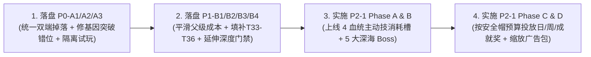

# 经济与成长曲线重平衡建议方案 (`ECONOMY_REBALANCE_PROPOSAL.md`)

> **适用阶段与原则**：本方案立足第一阶段审计实测结果，按 **P0（阻断级结构修复）→ P1（节奏与经济收敛）→ P2（P2-1 新系统安全接入窗口）** 给出可量化修改建议。**待主策划确认后，再与 P2-1 同步落盘修改源码与 `docs/03-GAME_BALANCE_AND_NUMERICAL_DESIGN.md` 等规范文档。**

---

## 1. 调优总体目标（Target Guardrails）

1. **消灭跨阶退化体验**：任何一次耗时攒资源完成的进化，新鲨鱼在 `Lv.1` 裸装下 **咬合阶位至少 `+1T`，HP/移速绝不出现负成长**，重塑“进化即飞跃”的核心爽感。
2. **对齐 Web 与 iOS 基础经济口径**：消除 Web 双重入账暴走与 iOS 后期悬赏/补给失效，让 **普通玩家解锁全 48 阶落在健康区间 `18 ~ 28 天`（约 `70 ~ 110` 局）**，且金币与基因形成 **“前期缺金币、中期双轮驱动、后期缺基因或高纯度突破材”** 的清晰张力。
3. **为 P2-1 预留 `30% ~ 40%` 资源投放预算**：避免 P2-1（血统技能 + Boss 战 + 每日/周/成就任务 + 广告商店）上线后出现数值通胀，确保任务和成就奖励成为**真正有用的中后期加速引擎**，而非“锦上添花的废纸”或“直接跳过两代的毁灭器”。

---

## 2. 分优先级调整清单（Actionable Proposal Matrix）

### P0 级（必须先于 P2-1 商业化/发奖逻辑前修正）

| 编号 | 问题描述与代码位置 | 当前实测数值 / 逻辑 | 建议调整值与实现方案 | 优先级理由与预期收益 |
| :--- | :--- | :--- | :--- | :--- |
| **P0-A1** | **修正 Web 吞噬“双重入账”与双端掉落统一** [`stepSimulation.ts:1038`](../src/game/sim/stepSimulation.ts#L1038-L1144) [`PreySimulation.swift:391`](../ios-native/HungrySharkEvolution/Rendering/PreySimulation.swift#L391-L398) | Web 吞噬直接加全额 `coinGain/geneGain` **同时**再爆 `2~6` 个拾取物二次加钱/基因（单鱼实得约设计值 `3~4x`）；iOS 仅靠拾取且非黄金仅 `38%` 掉基因 | **统一为单一结算源（拾取物保底+弹性溢出，无双重加账）**： ① 取消 Web 击杀直接 `+coins/+genes`（或取消拾取物额外数值，仅把 `coinGain/geneGain` 拆包成可磁吸飞舞粒子）； ② 双端统一基因掉落机制：T1~T17 常规鱼 `45%` 概率掉 `1~N` 基因（黄金/巨兽/悬赏/Boss/T18+ **100% 掉基因**），消除 Web `10x` 膨胀与 iOS 前期 `38%` 纯看脸卡死。 | 立即把 Web 基因通膨压回健康水位，同时让 Web 与 iOS 共用同一套平衡表与任务/广告数值。 |
| **P0-A2** | **对齐“基因突破收费”与“+1T 咬合发奖”节点，消除连续 23 阶进化倒挂** [`rules.ts:447`](../src/game/rules.ts#L447-L449) [`sharkEvolutionConfig.ts:969`](../src/game/sharkEvolutionConfig.ts#L969-L985) | 收费在 `Lv.4→5` & `Lv.9→10`，但 `+1T` 发在 `Lv.3/6/10`；且 `reqParentUpgradeLevel` 高达 `6/8/9` 导致父级满血高T压倒新鲨 `Lv.1` | ① **严格对齐节点**：将 `upgradeBiteBonus` 改为 `upLv >= 10 ? 2 : upLv >= 5 ? 1 : 0`（取消 `Lv.3` 免费跳阶，**每花 1 次基因突破必涨 `+1T`**，上限设为 `+2T`）； ② **封顶跨阶压制 & 下调 `reqParent`**：将 `G1..G6` 的 `reqParentUpgradeLevel` 收敛为 `[2, 3, 4, 5, 6, 7]`，或设定每只新鲨 `baseHp / baseSpeed` 至少保证 `>= 前一阶在 reqParentLv 时的 108% / 102%`；且若父级靠 `Lv.5` 升到了 `baseT+1`，下一阶鲨鱼 `baseBiteTier` 需同步顺滑或将父升级 `+1T` 仅用于**跨代越级打高阶鱼**而非反超子代。 | **彻底消除 23 阶 `-1T` 倒挂和 45 阶 `-45% HP` 退化感**；使每一笔基因突破升级都成为可见的高价值投资。 |
| **P0-A3** | **隔离试用鲨鱼与正式进度门禁** [`stepSimulation.ts:1413`](../src/game/sim/stepSimulation.ts#L1413-L1418) | 观看 `TRIAL_MAX_MECHA` / `TRIAL_SHARK` 试玩后，试玩局跑出的 `Lv.12+` 和 `5000m+` 深度永久覆盖 `bestInRunLevel` / `bestDepthReached` | 当 `shark.trialActive === true`（iOS `trialSharkIdForRun != nil`）时，**禁止刷新 `bestInRunLevel` 与 `bestDepthReached`**（允许正常带走该局赚取的金币与基因奖励作为体验福利）。 | 防止新玩家首局 1 次试用广告直接击穿全游戏 48 阶的所有等级与深度门禁。 |

---

### P1 级（解决核心成长断层、生态空档与跨端分裂）

| 编号 | 问题描述与代码位置 | 当前实测数值 / 逻辑 | 建议调整值与实现方案 | 预期收益 |
| :--- | :--- | :--- | :--- | :--- |
| **P1-B1** | **重塑父级强制强化成本曲线，扭转 G5/G6 “升级比买新鲨贵 2.56 倍”** [`sharkEvolutionConfig.ts:897`](../src/game/sharkEvolutionConfig.ts#L897-L985) | `baseUpgradeCoinCost * 1.36^(lv-1)` 叠至 `Lv.9` 达 `23.9 × base`；`#46 Lv.9` 要 `113,574C`，解锁 `#47` 仅 `44,400C` | ① 若保留 `1.36` 幂率，将 `reqParentUpgradeLevel` 上限设为 **`Lv.6`**（成本仅 `~9.1 × base`），把 `Lv.7~10` 定位为“喜爱该鲨鱼或冲金冠/深渊 Boss 的深度养成”； ② 或将升级递增系数从 **`1.36` 下调至 `1.24`**（`Lv.1→6` 总费用降低 ~`28%`，`Lv.1→10` 从 `26.1 × base` 降至 `18.3 × base`），并将省下的费用适度前移给解锁费用与 **P2-1 血统技能升级（Phase A）**。 | 解决“旧鲨过路费太贵”的厌烦感，同时腾出金币/基因消耗空间给即将开发的血统技能树。 |
| **P1-B2** | **统一双端悬赏与单鲨王冠产出机制** [`PreySimulation.swift:431`](../ios-native/HungrySharkEvolution/Rendering/PreySimulation.swift#L431-L435) [`GameRules.swift:298`](../ios-native/HungrySharkEvolution/Core/GameRules.swift#L298-L334) | ① 悬赏：Web 2杀随T动态扩充（最高 `600+G`），iOS 3杀固定 `+45C/+3G`；② 王冠：Web `0C/11.5kG` 难一倍，iOS `285kC/10.4kG` 前期溢出 | ① **悬赏双端拉齐**：统一 **`2~3` 杀随世代线性增长**：`bountyCoins = round((35 + T * 3.2) * coinMult)`，`bountyGenes = round((4 + T * 0.45) * geneMult)`； ② **王冠双端统一**：采用统一三档分数门槛，前 3 代适当下调金币赠送比例（仅补总需求的 `20%~30%`），把 **金币与基因奖励按鲨鱼阶位指数温和上扬**（G1 小奖、G4~G6 丰厚大奖）。 | 让悬赏始终有感但不再让 Web 基因泛滥，消除 iOS 前三代金币过剩与后期王冠无用问题。 |
| **P1-B3** | **随世代阶梯化 `SUPPLY_DROP` 广告补给 & 修复 Web 死广告位** [`GameViewModel.swift:612`](../ios-native/HungrySharkEvolution/State/GameViewModel.swift#L612-L613) [`adManager.ts:43`](../src/game/adManager.ts#L43-L47) | iOS 固定 `+300C / +25G`（G1 抵 1 局，G6 仅 `0.03%`）；Web 端 `GENE_SUPPLY_DROP` 与 `EVO_CLAIM_ALL` 无 UI 入口 | ① **动态按最高已解锁世代缩放补给包**：`coins = [180, 550, 1400, 3600, 9000, 22000][maxRow]`，`genes = [18, 55, 130, 320, 750, 1750][maxRow]`（约等于当前世代 `0.6~0.8` 局纯收益，日限 `5~6` 次）； ② **结算翻倍设每日满额高光次数（如前 `3` 次高收益局 `2x`，后续 `1.5x`）**； ③ Web 端将补给入口接入 HUD/图谱或等待 P2-1 Phase D 统一落地。 | 前期不再靠 10 个固定广告直接白嫖毕业，中后期看广告始终保持清晰的正向价值。 |
| **P1-B4** | **补全 `T33~T36` 生态空档、重构巨鲨深潜出生点与 `reqMaxDepth`** [`stepSimulation.ts:469`](../src/game/sim/stepSimulation.ts#L469-L470) [`sharkEvolutionConfig.ts:785`](../src/game/sharkEvolutionConfig.ts#L785-L788) | ① `T33~T36` 零猎物；② `24.5m+` 巨鲨开局空海；③ `reqMaxDepth` 封顶 `1,450m` | ① 从现有过密 `T1` 浅海群（89 种）中抽调部分或重分 `12~16` 种中型/深海生物填补 `T4~6, T17, T19, T25~27, T33~36`（或在配置表中平缓压缩 `48` 阶体型梯度）； ② `#32+`（体长 `>= 21.5m`）巨鲨开局初始出生水深自动下移至 **`400m ~ 850m`**（或给予前 `8s` 深海下潜加速护盾）； ③ 将 `reqMaxDepth` 从 `[0, 300, 540, 850, 1180, 1450]` 延伸至 **`[0, 220, 650, 1800, 4200, 7000]`**，真正牵引玩家探索 Z4 深渊与 Z5 冥渊 100 种巨物。 | 让 `0m → 11,000m` 五大海洋带和 234 种猎物形成全程无缝衔接的生态阶梯。 |

---

### P2 级（调优局内战术消耗 & 对接 `P2-1` 新系统资源预算）

| 编号 | 模块与规划对接点 | 调整方案与数值设计建议 |
| :--- | :--- | :--- |
| **P2-C1** | **重做局内 `GoldOverdrive` & `GeneSurge` ROI** | ① `GoldOverdrive` 第 1 次基础消耗改为挂钩 `max(40, round(预期单局金币 * 0.08))`（避免 G1 负收益、G6 仅占 `0.09%`），开启时附加 **`+25%` 期间掉落加成** 提升战术爽感； ② `GeneSurge` 保持冲级救急功能，同时把 `reqMaxInRunLevel` 终点从 `Lv.18`（需单局 `7.4万` XP）调整到更合理的 `Lv.14~15`（或提升 Z4/Z5 猎物 XP 系数 `+25%`），使不靠无尽复活也能依靠技术冲进门槛。 |
| **P2-C2** | **对接 P2-1 Phase A（血统主动技能升级）资源分流** | 按每条血统 `1` 个大招 + 升至满级 `Lv.5` 共 4 条血统计算，建议设定全血统满技能累计吸收 **约 `180,000 ~ 250,000` 金币 + `18,000 ~ 25,000` 基因**（相当于现有养成总盘的 ~`15%` 独立横槽），**严格在推进 Phase B/C 每日发奖前把该消耗槽实装上线**，确保新增奖励有去处。 |
| **P2-C3** | **对接 P2-1 Phase B/C（Boss 首杀、每日任务与成就奖池安全帽）** | 在 `P0-A1` 拉齐单局产出（假设调优后每代单局纯收益与 iOS 当前接近但基因稳步翻倍、耗时目标 `~80~100` 局全通）的前提下，建议为 Phase B/C 设置如下 **安全发奖上限预算**： ① **每日任务 3 档合计**：单日约等同当前世代 **`0.8 ~ 1.2` 局净收益**（例：以“固定基数 + 世代倍率”发放，约占高活跃日产出的 `10%~15%`，但让轻度 `1~2` 局玩家稳定每天保底升 1 级）； ② **周常目标合计**：相当于 **`2.5 ~ 3.5` 局** 收益，绑定“下潜突破 / 击杀深海领主 Boss”，强牵引内容探索； ③ **5 大深海 Boss 首杀奖励（一次性）**：重点投放 **一次性稀有突破基因包 + 解锁血统共鸣槽位**，占该世代基因总需求的 `25%~35%`（避免一次给足整代全买完）；后续重复击杀按常规高阶猎物 `2.5x` 结算； ④ **全局里程碑成就（一次性）**：总投放严控在 **全周期累计消耗的 `12% ~ 18%`** 以内，且分散锁定到“累计吞噬 / 深度突破 / 多血统使用 / 图鉴解锁数量”各节点，绝不在早期一次性倾泻。 |

---

## 3. 执行路线图建议（与 `09-P2_1_RETENTION_MONETIZATION_PLAN.md` 协同顺序）

- **核心约束提醒**：未来正式执行上述代码与公式修改时，请务必按 [`AGENTS.md`](../AGENTS.md) 同步更新 [`docs/03-GAME_BALANCE_AND_NUMERICAL_DESIGN.md`](./03-GAME_BALANCE_AND_NUMERICAL_DESIGN.md)、[`docs/06-PREY_DATABASE_140.md`](./06-PREY_DATABASE_140.md) 及 [`scripts/build-ios-native.ts`](../scripts/build-ios-native.ts) 数据契约，并通过 `npx tsx --test src/game/rules.test.ts` 与 `swift test`。
